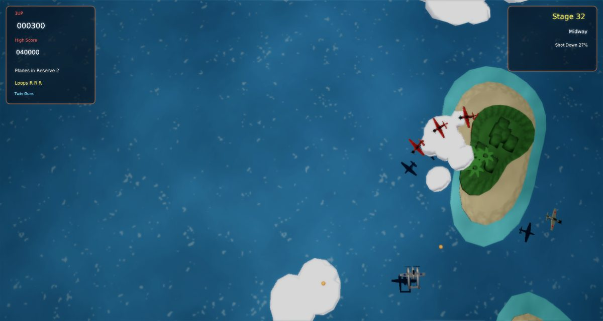

# 1942 Remix

A faithful modern remake of Capcom's **1942** (1984) for [Phasma Engine](https://github.com/christoskaramou/PhasmaEngine).
Take off from the carrier in your P-38 "Super Ace" and fight across the Pacific from Midway (stage 32) to Tokyo
(stage 1). At the end of each stage you land back on the carrier.

## Highlights
- **The arcade structure.** 32 stages counting down from 32 (Midway) through Marshall, Attu, Rabaul, Leyte, Saipan,
  Iwo Jima and Okinawa to 1 (Tokyo). Every stage opens with a take-off from the carrier and ends with a landing and a
  shoot-down report: the percentage of enemies destroyed earns a bonus, and 100% earns a "Perfect" 20000.
- **Guns and loops.** Twin machine guns fire one volley per press, as on the arcade, with up to three volleys on
  screen at once. Each stage gives you three loop-the-loops: the plane pulls up through a full loop and can't be hit
  while it does.
- **Red formations and POWs.** Shoot down all five planes of a red formation and a POW appears.
  - Red: Quad Guns. Green: two Side Fighters that fly and fire with you, and each one takes a single hit.
  - White: destroys every enemy on screen. Gray: an extra loop.
  - Yellow: enemies stop firing for 10 s. Orange: 1000 points.
  - Quad Guns and Side Fighters are lost when you're shot down.
- **Enemies.**
  - Zeros dive at you, loop, weave across from the sides, swoop in from the corners and climb up from behind.
  - Medium bombers fire three-way spreads and take 14 hits.
  - Every fourth stage (29, 25 … 1) ends with the Ayako heavy bomber. Its alternating spread salvos come from the
    nose and the wing guns. It escapes if you don't bring it down in time.
  - Waves are fixed for each stage, so each stage plays out the same every time, like the arcade.
- **Lives**: 3 planes. Extra planes at 20000, 80000 and every 80000 after that.
- **Modern 3D look without neon**: modelled P-38, Zero, bomber and Ayako aircraft with spinning propellers and banking
  turns. Each plane casts its own silhouette shadow on the sea. The scrolling Pacific has whitecaps, coral-reef
  islands with palms, low clouds and a full aircraft carrier with deck markings. Explosions have fire, smoke, debris and
  light flashes.
  - Render settings: TAA on, CAS off (HDR off), soft bloom (strength 0.55, range 1.2).
- **Fair collisions**: every aircraft uses a set of circles that follow its fuselage and wings, rotated with the
  plane. Your hit circle is small (0.36 units) and centred on the cockpit. Your shots are tested along their whole path
  each step, so they never skip through a plane. Press **F3** to show every collider: your plane and escorts, each
  enemy's circles, shot paths, bullets, POW pick-up range and the field edges.
- **Fixed 60 Hz simulation** with capped catch-up, so the game plays the same at 40 to 144 FPS.
- **Mouse-clickable menus**: title, pause, game over / victory, and the shared settings menu. The cursor is hidden
  during play.

Notes: the stage names and order, POW colours, three loops per stage, take-off and landing, and shoot-down bonus
follow the arcade game. The wave layouts are a recreation built per stage, not the original data. Point values and the
bonus table are close but not exact, and the music is an original march, not Capcom's tune.

## Controls
| Input | Action |
|---|---|
| WASD or Arrow keys | Fly in eight directions |
| Space / Z / J / Left Click | Fire (one volley per press) |
| X / K / Shift / Right Click | Loop-the-loop (three per stage, invulnerable while looping) |
| P / Esc | Pause |
| O | Settings |
| M | Mute |
| F3 | Collider overlay |
| Mouse | Click any menu button |

## Run
`run.cmd` (or `run.ps1`) searches upward for a `PhasmaEngine` checkout and starts the player with this project.

## Files
- `Assets/Scripts/game.lua`: the whole game. It is built from `tools/src/0*.lua` by `tools/build_lua.sh`.
- `tools/gen_meshes.py`: generates the aircraft, carrier, islands, clouds and shadow meshes. `tools/gen_scene.py`
  generates the template scene. `tools/gen_assets.py` generates the ocean, deck and POW textures and all sound.
- `shots/`: screenshots of the title, take-off, a stage, POWs with Side Fighters and Quad Guns, a loop, the Ayako
  boss, landing, the stage report, game over and the F3 overlay.
