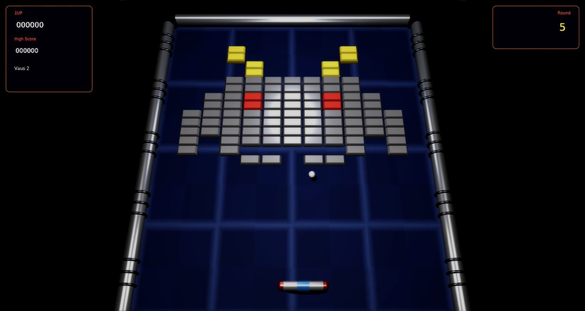

# Arkanoid Remix

A faithful modern remake of Taito's **Arkanoid** (1986) for [Phasma Engine](https://github.com/christoskaramou/PhasmaEngine).
Steer the Vaus, keep the energy ball in play and clear 32 rounds of bricks. Then face DOH in round 33.

## Highlights
- **The arcade rules**: 13-column field.
  - Brick values: white 50, orange 60, cyan 70, green 80, red 90, blue 100, pink 110, yellow 120.
  - Silver bricks take 2 hits, plus one more every 8 rounds, and score 50 x the round number. Gold bricks can't be broken. They have a polished amber sheen with a glint sweeping across them, so they stand apart from the matte lemon yellow bricks.
  - 3 lives, with an extra Vaus at 20000 and every 60000 after that.
- **Rounds**: rounds 1 (six rows), 2 (the staircase), 3 (rows between gold bars) and 5 (the space invader) follow the
  arcade layouts. The others are built in the same style: columns, diamond, gold maze, checkerboards, castles and waves.
  Round 33 is DOH. He takes 16 hits and fires shots aimed at the Vaus.
- **Capsules** drop from broken bricks. Only one can be falling at a time, and none drop while you have more than one
  ball. Each one is worth 1000 points.
  - **S** Slow, **C** Catch, **L** Laser (twin shots, one pair per press).
  - **E** Enlarge, **D** Disruption (3 balls), **B** Break (a warp gate opens on the right wall and is worth 10000).
  - **P** Extra Vaus.
  - A new capsule replaces the previous effect, as in the arcade.
- **Ball behaviour**: the bounce angle depends on where the ball hits the Vaus. The ball speeds up when it first hits
  the top wall and after every 12 hits off the Vaus.
- **Enemies** float in through the two gates in the top wall and slide around the bricks. They're destroyed by the
  ball, by lasers, or by touching the Vaus (100 points each).
- **Modern 3D look without neon**: bevelled bricks that pulse when hit, chrome frame pipes with collars, a capsule-shaped
  Vaus with red end caps, spinning lettered capsules, four backdrop patterns that cycle per round, a stone DOH face, and
  particles, sparks and light flashes.
  - Render settings: TAA on, CAS off (HDR off), soft bloom (strength 0.55).
- **Fair, swept collisions**: the ball moves in sub-steps of at most 0.08 units and resolves the deepest brick contact,
  so it never passes through a brick. Lasers are tested along their whole path. Press **F3** to show the Vaus box, the
  ball, every brick box, capsules, enemies, shots, DOH and the field walls.
- **Fixed 60 Hz simulation** with capped catch-up (40-144 FPS). Mouse-clickable title, pause, game over and settings
  menus. The cursor is hidden while you play.

## Controls
| Key | Action |
|---|---|
| A / D / Left / Right / Mouse | Move the Vaus |
| Space / Z / J / W / Up / Left Click | Launch the ball, fire the laser (one shot per press) |
| P / Esc | Pause |
| O | Settings |
| M | Mute |
| F3 | Collider overlay |

## Run
`run.cmd` or `run.ps1` (Windows). Meshes and sounds are generated by `tools/` (gen_meshes.py, gen_assets.py). The music is original.
