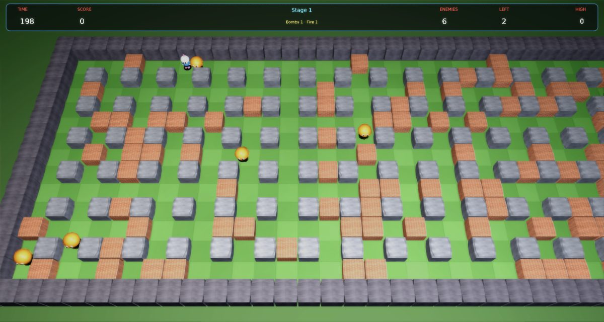

# Bomberman Remix

A faithful modern remake of Hudson Soft's **Bomberman** (1983/1985) for
[Phasma Engine](https://github.com/christoskaramou/PhasmaEngine). Bomb your way through the brick maze, find the exit
door hidden under one of the bricks, and clear out every enemy before the 200-second timer runs out.

## Highlights
- **The original arena**: 31 × 13 cells inside a solid border, with concrete pillars on every other cell and randomly
  placed brick walls. The start corner is always kept clear. The camera scrolls sideways with you, like the NES version.
- **Original rules.**
  - Bombs burn for 2.6 s, then blast in a cross. Flames stop at pillars, destroy the first brick in each direction,
    and set off other bombs in a chain reaction.
  - Each stage hides an exit door and one power-up under bricks. Bombing an uncovered exit or power-up releases a wave
    of 8 tougher enemies.
  - The exit opens only once every enemy is gone. If the 200-second timer runs out, 8 Pontans appear.
  - When you die, you keep Bomb Up, Fire Up and Speed Up. Detonator, Wall Pass, Bomb Pass and Flame Pass are lost.
- **The eight classic enemies**, with their original point values. Several enemies caught in the same blast score
  double each time (×2, ×4 and so on).
  - Ballom 100, Onil 200, Dahl 400, Minvo 800, Doria 1000, Ovape 2000, Pass 4000, Pontan 8000.
  - Each has its original speed and the right ability to pass through walls.
  - The smarter enemies chase you when you're close.
- **The eight power-ups**, in the NES stage order for all 50 stages: Bomb Up, Fire Up, Speed Up, Wall Pass,
  Detonator, Bomb Pass, Flame Pass and Mystery (10 s of invincibility).
- **50 stages.** Stages 1-20 use enemy line-ups modelled on the NES game. Stages 21-50 are a recreation that leans on
  Doria, Ovape and Pass, because the exact original tables aren't publicly documented. The NES bonus stages are not
  included.
- **Characters and props**: cooked 3D models.
  - Bomberman has a white helmet with a pink antenna knob, a peach face, a blue suit, white gloves and pink boots. He
    walks, does a death spin and celebrates at the exit.
  - Also each enemy, glossy fused bombs that pulse faster as they're about to go off, a flame cross with an inner
    core, bricks that crumble, a lit exit door, and power-up panels with icons.
- **Modern look without neon**: a textured grass checker, concrete and brick materials, soft key and fill lights,
  blast flashes, fire, smoke and debris particles, fuse sparks and screen shake.
  - Render settings: TAA on, CAS off (HDR off), soft bloom (strength 0.55, range 1.2).
- **Fair collisions**: Bomberman's wall box is 0.84 cells wide, and corner assist slides him into a lane when he's
  slightly off it.
  - Flames only kill the cell your centre is in.
  - You only touch an enemy when your centres are within 0.62 cells of each other.
  - Press **F3** to show walls, bricks, bombs, flames, the player's wall box and hurt box, enemies, the exit and the
    power-up.
- **Fixed 60 Hz simulation** with capped catch-up, so speeds are the same at 40 to 144 FPS.
- **Mouse-clickable menus**: title (with Continue from your furthest stage), pause, game over, and the shared
  settings menu. The cursor is hidden during play.

## Controls
| Input | Action |
|---|---|
| WASD or Arrow keys | Walk. With a diagonal held, Bomberman takes whichever way is open |
| Space / Z / J / Left Click | Drop a bomb (one per press) |
| X / K / Right Click | Detonate the oldest bomb (needs the Detonator) |
| P / Esc | Pause |
| O | Settings |
| M | Mute |
| F3 | Collider overlay |
| Enter / Space / Click | Skip the stage card |
| Mouse | Click any menu button |

## Run
`run.cmd` (or `run.ps1`) searches upward for a `PhasmaEngine` checkout and starts the player with this project.

## Files
- `Assets/Scripts/game.lua`: the whole game. It is built from `tools/src/0*.lua` by `tools/build_lua.sh`.
- `tools/gen_meshes.py`: generates the meshes. `tools/gen_scene.py` generates the template scene.
  `tools/gen_assets.py` generates the textures, power-up icons, skybox and sound.
- `shots/`: screenshots of the title, several stages, a blast, the F3 overlay and close-ups.
