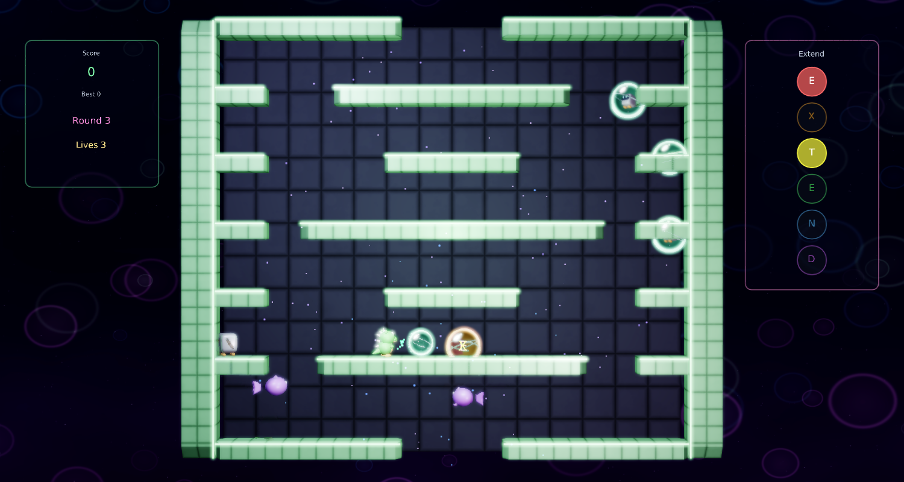
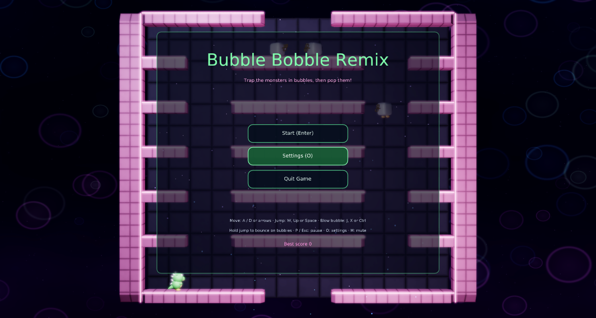
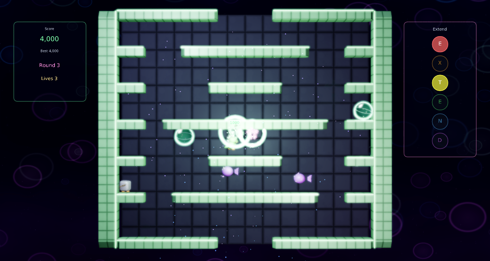
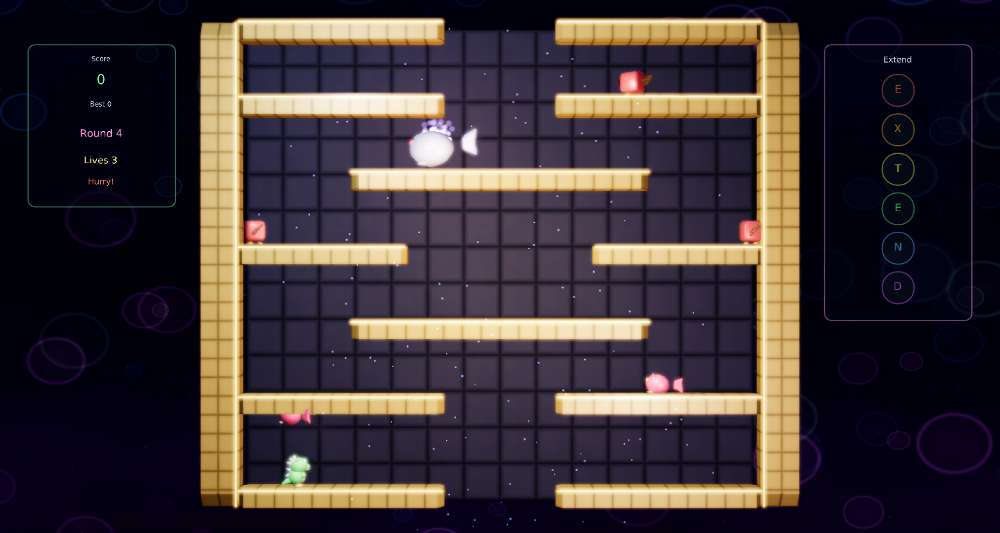

# Bubble Bobble Remix

A modernized remake of Taito's **Bubble Bobble** (1986) for
[Phasma Engine](https://github.com/christoskaramou/PhasmaEngine). You are Bub, a bubble dragon. Blow bubbles to trap
the monsters, pop them to defeat them, and grab the fruit they leave behind.

## Highlights
- **Faithful core**: single-screen rounds with one-way platforms you jump up through, and a hole in the floor and
  ceiling that drops you back in from the top. Blow a bubble to trap a monster, then touch it to pop it. Popping
  touching bubbles together sets off a chain, and each monster in the chain doubles the points (1000, 2000, 4000...).
  Defeated monsters spin away and land as fruit (cherry, banana, peach, gem). Hold jump to bounce on top of bubbles.
  A trapped monster that is left too long breaks free angry (red and faster).
  Letter bubbles rise from the floor hole: collect E-X-T-E-N-D for an extra life.
  Take too long and you get "Hurry Up!" (all monsters turn angry), then **Baron von Blubba** comes for you through walls.
  Five layouts (Bubble Cave, Twin Stairs, Crystal Tower, Zig Zag, Floating Isles) cycle and get harder with
  extra monsters. Clearing a round scrolls to the next one while Bub floats to the start in a bubble, as in the arcade.
  Monsters: Zen-chan (wind-up robot, walks and jumps) and Monsta (flying whale ghost that bounces off walls).
  You also get an extra life every 50,000 points, and your high score is saved.
- **Cooked meshes**: Bub (body, belly, spikes, eyes, animated feet, squash and stretch, blow animation), Zen-chan
  (rounded body, visor, glowing eyes, spinning wind-up key), Monsta, Baron von Blubba, bubbles (rim ring, shimmer band,
  inner shell and highlight, so a trapped monster stays visible inside), fruit, star debris, and a tiled level block mesh
  with glowing trims for each round. All are generated by `tools/gen_meshes.py` (zero-area triangles are dropped before
  cooking), cooked with `PhasmaCook`, and cloned from `.pescene` templates at runtime.
- **VFX and lighting**: layered pop bursts with expanding rings and light flashes, trap sparkles, tumbling star debris on
  defeat, fruit sparkles, landing dust, a jump trail, Baron's smoke trail and red glow, ambient sparkles, dynamic point
  lights with a colour accent for each round, and an HDR skybox for IBL.
- **Render settings**: HDR on, TAA on, CAS off, FXAA off, motion blur off, `bloom_strength` 0.55, `bloom_range` 1.25.
- The shared **settings menu** is mouse-clickable, with volume at 50% by default. The title, pause and game-over
  buttons can be clicked too.

## Controls
| Input | Action |
|---|---|
| Left / Right or A / D | Move |
| W / Up / Space | Jump (hold it to bounce on bubbles) |
| J / X / Ctrl | Blow a bubble (hold to keep blowing) |
| P / Esc | Pause |
| O | Settings |
| M | Mute |
| Mouse | Click any menu button |

## Run
`run.cmd` (or `run.ps1`) starts PhasmaPlayer from the newest `PhasmaEngine\build*\Release` build, using a private
runtime folder under `%LOCALAPPDATA%\PhasmaGames\BubbleBobbleRemix`.

## Screenshots
| | |
|---|---|
|  |  |
|  |  |
