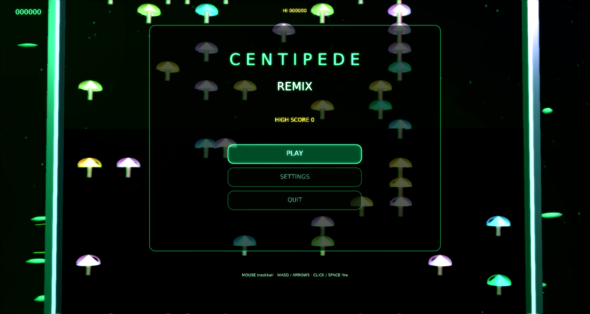

# Centipede Remix

A modernized remake of Atari's **Centipede** (1981) for
[Phasma Engine](https://github.com/christoskaramou/PhasmaEngine), set on a bioluminescent forest floor.



## Highlights
- **Faithful rules**: snaking / splitting centipede, damageable mushrooms (restored between lives),
  flea (drops mushrooms when the player area is sparse), spider (proximity scoring), scorpion
  (poisons mushrooms so the centipede dives), 3 blades, extra life at 10,000.
- **Trackball-like mouse** aim plus WASD / arrows; click or Space to fire.
- **Cooked glossy meshes**: segmented centipede bodies/heads, glowing mushrooms (cap / stem / underside),
  blaster, spider, flea, scorpion — generated by `tools/gen_meshes.py`, cooked with `PhasmaCook`,
  cloned from `.pescene` templates at runtime.
- **VFX**: spore / sap / spark particle bursts, dynamic point lights on the blaster and enemies,
  pulsing biolume frame, forest HDR IBL.
- **TAA + smooth bloom** (see `/workspace/games/common/RENDER_SETTINGS.md`): `taa` on,
  `cas_sharpening` off (so bloom is not overwritten), `bloom_range` 1.4, `bloom_strength` 0.55, `hdr` on, motion blur off.
- Shared **settings menu** (`Assets/Scripts/Lib/settings_menu.lua`): master volume defaults to 50%,
  mouse-clickable options.

## Controls
| Input | Action |
|---|---|
| Mouse | Trackball-like aim (blaster follows cursor) |
| WASD / Arrows | Move |
| Left click / Space | Fire |
| Esc / P | Pause menu |
| O | Settings |
| M | Mute |

## Run (Windows)
```powershell
.\run.ps1          # or double-click run.cmd
```
Needs a local Phasma Engine build at `../../../PhasmaEngine/build*/Release/PhasmaPlayer.exe`
relative to this folder. `run.ps1` copies the player into `%LOCALAPPDATA%\PhasmaGames\CentipedeRemix`.

## Regenerating assets
`tools/gen_meshes.py` → OBJ → `PhasmaCook` → `Assets/Objects/*.pemesh`.
`tools/gen_assets.py` writes textures, HDR sky and WAV sfx. `tools/gen_scene.py` writes templates.

## Playtest fixes (2026-10-16)
- Camera now fits the whole field, including the blaster zone at the bottom (it was cropped off-screen).
- Meshes: zero-area triangles are dropped at generation time (they made PhasmaCook split the bullet mesh, so the shot was invisible).
  New centipede meshes: round bead segments with leg pairs, and a head with eyes, antennae and mandibles. Segments follow the exact cell path one cell apart, so the centipede reads as a chain.
- Classic rules: one fast shot on screen at a time, with a swept hit test so it can't skip past targets at low FPS. The flea takes 2 hits and speeds up after the first. Segments split and leave mushrooms. The spider, the scorpion's poisoned mushrooms and the bottom-zone blaster work as in the original.
- Frame-rate independent: the simulation runs in fixed 1/60 s substeps.
