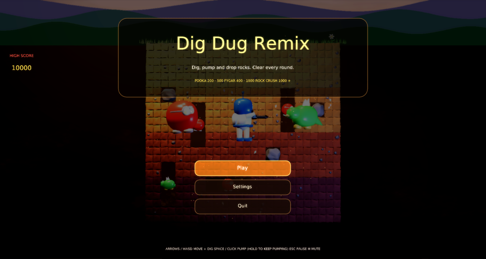
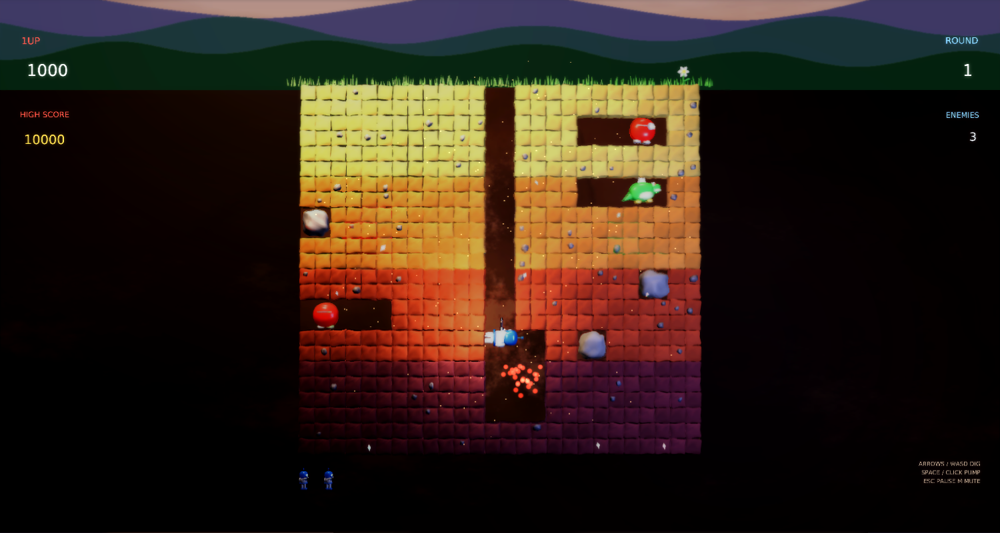
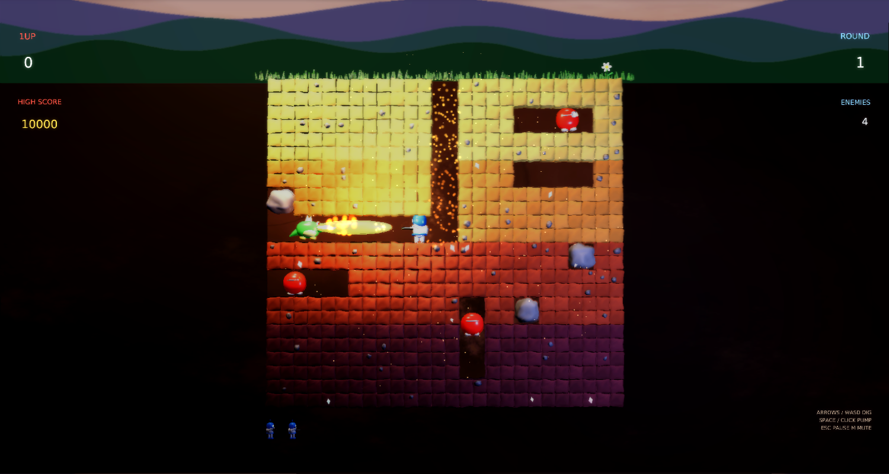
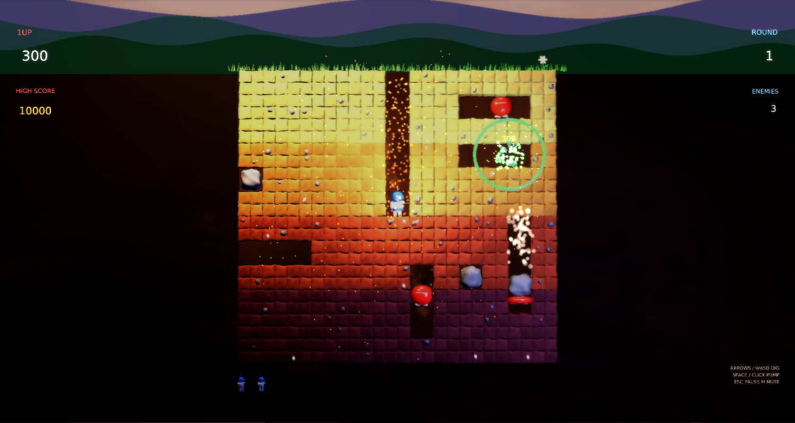

# Dig Dug Remix

A modernized remake of Namco's **Dig Dug** (1982) for PhasmaEngine (Lua).

## Gameplay
- Dig through four strata of earth, then inflate **Pookas** and **Fygars** with the air pump. Four pumps pop them.
  Pop scores grow with depth (200/300/400/500), and a Fygar pumped horizontally scores double.
- Dig under a **rock** to make it wobble and drop. It crushes every enemy in its path (1000, 2500, 4000, ... for multi-crush) and can crush you too.
- After two rocks fall, a **bonus vegetable** appears in the centre for 10 seconds.
- Enemies turn into **ghosts** (only their eyes stay visible) and drift through solid dirt toward you.
- Fygars **breathe fire** through dirt. Watch them charge.
- The **last enemy flees** to the surface. Catch it before it escapes.
- Glowing **gems** are buried in the earth (250 pts). Extra lives come at 10k, 40k, 80k and 120k.

## Controls
| Action | Keys |
|---|---|
| Move / dig | Arrows or WASD. Corners are forgiving: hold the new direction and the digger snaps to the next lane |
| Pump | Space, Left Ctrl or left click. Hold to keep pumping |
| Pause | Esc / P |
| Mute | M |
| Menus | Mouse (all buttons are clickable) or arrows + Enter |

## Visuals
Cooked meshes (PhasmaCook) for the digger, Pooka, Fygar, rocks, rounded voxel earth blocks, pebbles, gems, flowers, vegetables, harpoon and flames.
Warm headlamp point light, fire and pop flash lights, dig crumbs, rock dust, pop confetti with debris shards and shockwave rings,
ghost wisps, floating dust motes, and a dawn sky with parallax hills. TAA is on, with soft smooth bloom (strength 0.5, range 1.2, CAS off;
see the RENDER_SETTINGS notes). The shared settings menu covers volume, quality, bloom, AO, particles, screen shake and FPS.

## Run
`run.cmd` (or `run.ps1`) launches the newest PhasmaPlayer build found under `..\..\..\PhasmaEngine\build*\Release`.

## Screenshots
| | |
|---|---|
|  |  |
|  |  |

`tools/` contains the procedural generators: `gen_meshes.py` (OBJ, cooked with `cook_all.sh`), `gen_assets.py` (textures + sfx) and `gen_scene.py`.
