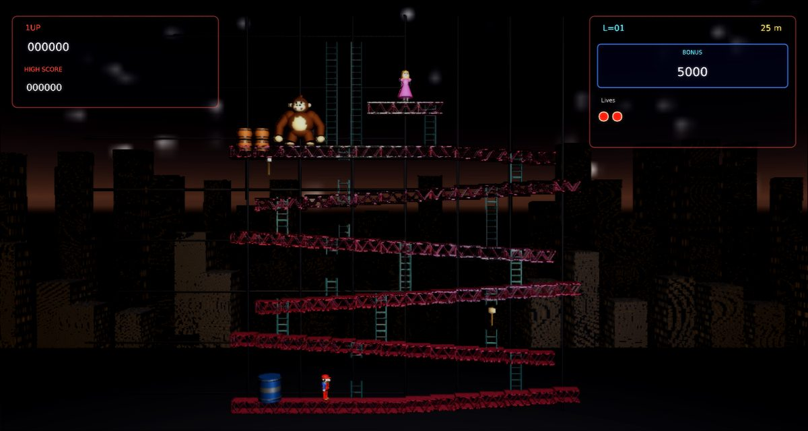

# Donkey Kong Remix

A faithful modern remake of Nintendo's **Donkey Kong** (1981) for
[Phasma Engine](https://github.com/christoskaramou/PhasmaEngine). Climb the construction site, jump the barrels,
grab a hammer, and rescue Pauline from Kong.

## Highlights
- **All four original stages, using the arcade layouts.** The game simulates the original 224×256 pixel playfield at a
  fixed 60 Hz, with capped catch-up so speeds match at any frame rate.
  - **25m girders**: six sloped girders (1 px per 16 px segment), full and broken ladders, Kong's barrel stack and two
    hammers. Barrels pick ladders at random, and pick them more often when Mario is below. The first barrel of each life
    is a blue barrel dropped straight into the oil drum, which lights it and releases a fireball. Later barrels include
    blue ones that spawn more fireballs, and wild bouncing barrels at higher difficulty.
  - **50m conveyors**: reversing belts carry Mario and the cement pies. Retractable ladders slide up and down,
    firefoxes spawn from the central oil fire, and Kong patrols the top belt.
  - **75m elevators**: rising and falling lift shafts, a crushing motor at the top and a bottomless pit below.
    Kong throws bouncing springs that drop down the right-hand column, and fireballs patrol the right-hand towers.
  - **100m rivets**: pull all 8 rivets by walking or jumping over them. Each one leaves a gap in the floor.
    Firefoxes chase you. When the last rivet goes, the tower collapses and Kong falls head first.
- **Original rules.** US stage order: L1 25-100, L2 25-75-100, L3 25-50-75-100, L4 25-50-25-75-100, then
  25-50-25-75-25-100.
  - The bonus timer starts at 5000 (+1000 per level, up to 8000) and drops 100 every 2 s. When it reaches 0, Mario dies.
  - Jumping obstacles scores 100 for one, 300 for two and 800 for three or more. Hammer smashes score
    300/500/800 for barrels and 500 for fireballs and pies. Pauline's hat, purse and umbrella score 300/500/800.
    Rivets score 100.
  - You get an extra life at 7000 points. A fall of more than about 12 px kills Mario.
- **Cutscenes**:
  - The intro: Kong climbs the ladders with Pauline, then stomps along the top girder, and each stomp bends a
    girder into its slant.
  - "How High Can You Get?" with a stack of Kongs, one per 25 m.
  - Stage clear: a heart appears, Kong snatches Pauline, and the heart breaks.
  - The 100m ending: Kong falls, and Mario and Pauline meet under a heart.
- **Characters**: cooked 3D models with animated parts, faithful to the arcade look.
  - Mario: red cap, red overalls, blue shirt and mustache. He walks, climbs, jumps, swings the hammer and has a death spin.
  - Kong: brown fur with a tan face and chest, and no tie. He beats his chest, grabs and throws barrels, climbs, hops,
    and falls upside down.
  - Pauline: pink dress, waving and calling "HELP!".
  - Also barrels, blue barrels, the oil drum, fireballs, firefoxes, cement pies, springs, conveyors, elevators,
    rivets, hammers and Pauline's items.
- **Modern look without neon**: a night city skyline HDR, dynamic point lights, oil-drum fire and smoke particles,
  flame particles on enemies, smash sparks, dust from Kong's stomps, and screen shake.
  - Render settings: TAA on, CAS off (HDR off), soft bloom (strength 0.55, range 1.2).
- **Fair collisions**: Mario's crash box (8×12 px) is smaller than his mesh. Hazards only kill inside their visible
  danger zones. Landing is forgiving, and a grounded Mario is never pushed through a floor.
  - Press **F3** to show every collider: floors, ladders (including the climbable limit of broken and retractable
    ladders), Mario, the hammer swing, enemies, Kong, the fire and items.
- **Mouse-clickable menus**: title, pause, game over, and the shared settings menu (volume at 50% by default).

## Controls
| Input | Action |
|---|---|
| A / D or Left / Right | Walk |
| W / S or Up / Down | Climb ladders. With a diagonal held, Mario takes whichever way is open |
| Space / Z / J | Jump (one jump per press) |
| P / Esc | Pause |
| O | Settings |
| M | Mute |
| F3 | Collider overlay |
| Enter / Space / Click | Skip the intro |
| Mouse | Click any menu button |

## Run
`run.cmd` (or `run.ps1`) searches upward for a `PhasmaEngine` checkout and starts the player with this project.

## Files
- `Assets/Scripts/game.lua`: the whole game. It is built from `tools/src/0*.lua` by `tools/build_lua.sh`.
- `tools/gen_meshes.py`: generates the character and prop meshes. `tools/gen_scene.py` generates the template scene.
  `tools/gen_assets.py` generates the textures, skybox and sound.
- `shots/`: screenshots of the intro, each stage, the cutscenes and character close-ups.
