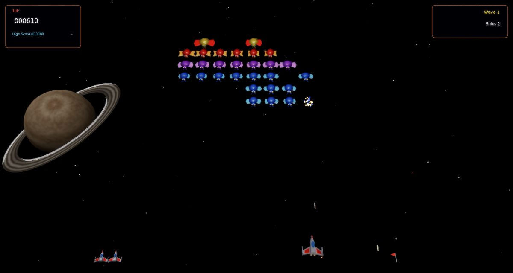
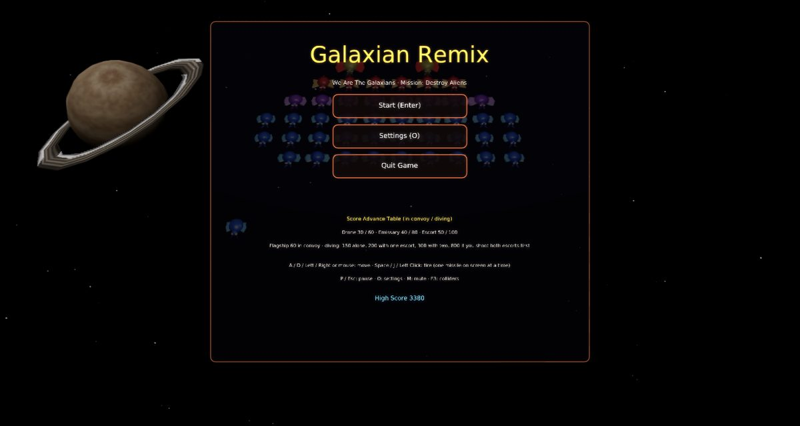
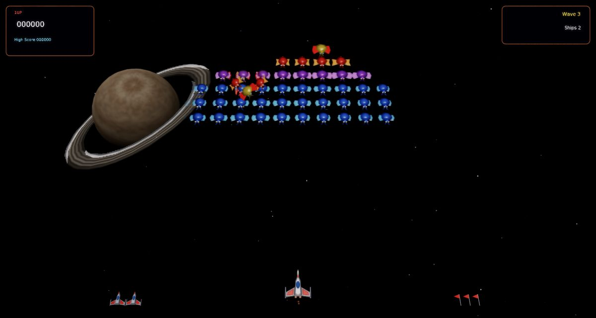
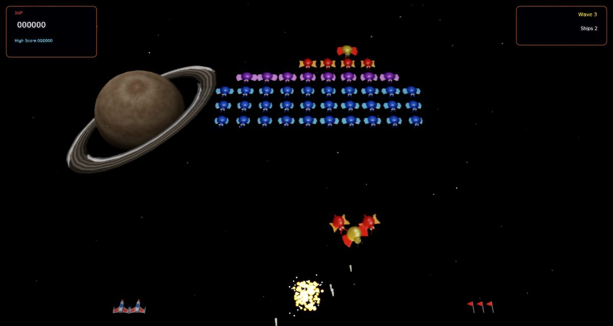
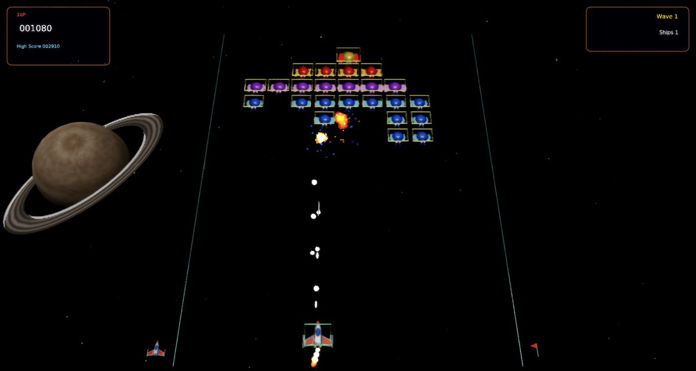
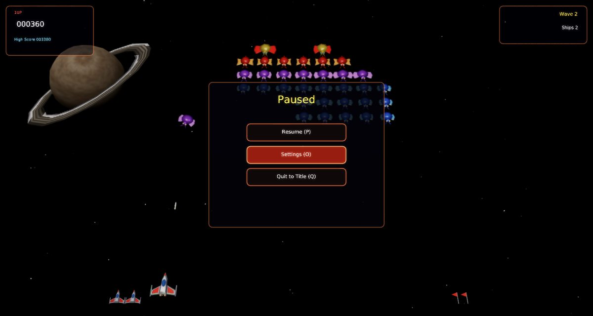
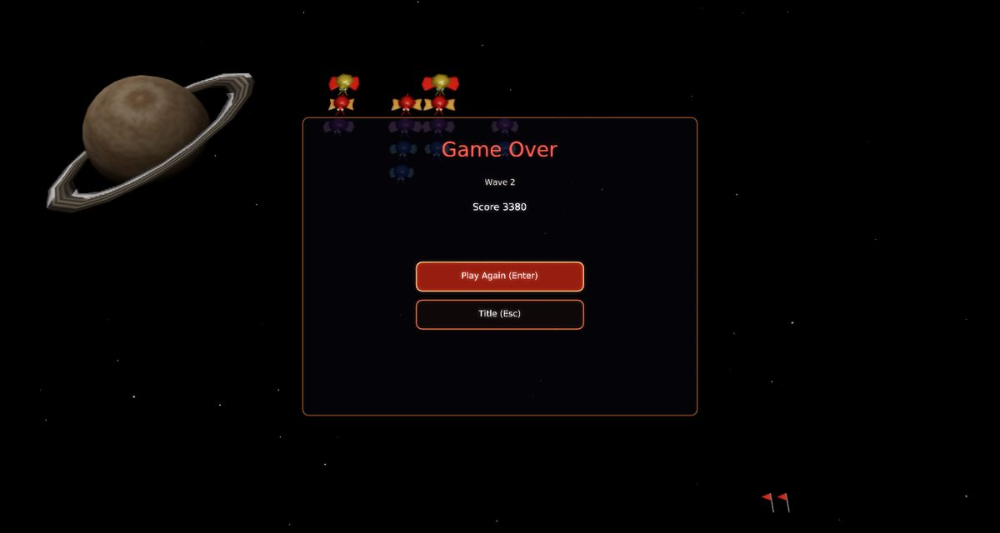

# Galaxian Remix

A faithful modern remake of Namco's **Galaxian** (1979) for [Phasma Engine](https://github.com/christoskaramou/PhasmaEngine).
We are the Galaxians. Mission: destroy aliens.

## Highlights
- **The arcade convoy**: 46 aliens in 10 columns. From the top: 2 flagships, 6 red escorts, 8 purple emissaries and
  30 blue drones. The convoy sways from side to side between the walls, and the aliens flap their wings.
- **Dives**: aliens peel off the ends of the convoy, alternating sides. Each one loops up and out, then swoops down at
  the Galaxip, weaving and dropping bombs. Divers that miss fly off the bottom, reappear at the top and fly back to
  their place in the convoy. When only a few aliens are left, they keep attacking without going home.
  - A flagship can take up to two red escorts with it.
  - From wave 3, drones sometimes dive in pairs.
  - Every wave dives faster, more often and with more bombs.
- **One missile at a time**: the Galaxip carries a single missile on its nose. You can't fire again until that missile
  hits something or leaves the screen.
- **Score advance table**:

  | Alien | In convoy | Diving |
  |---|---|---|
  | Drone (blue) | 30 | 60 |
  | Emissary (purple) | 40 | 80 |
  | Escort (red) | 50 | 100 |
  | Flagship | 60 | 150 alone, 200 with one escort, 300 with two, 800 if you shoot both escorts first |

  You start with 3 Galaxips and get an extra one at 7,000 points. After you lose a ship, play resumes only once every
  attacker has returned to the convoy, as in the arcade. Reserve ships are shown at the bottom left and wave flags at
  the bottom right.
- **Modern 3D look without neon**: modelled insects with flapping wings and glowing eyes, a white and red Galaxip with
  engine glow and banking, a twinkling starfield that scrolls down like the original, a distant ringed gas giant, and
  coloured bursts and explosion flashes.
  - Render settings: TAA on, CAS off (HDR off), soft bloom (strength 0.55).
- **Collisions**: hit boxes match the models. The missile is swept between frames, so it can't skip past an alien,
  and the bombs are swept against the Galaxip. A diver that rams the Galaxip destroys both.
- **F3 collider overlay**: shows the walls, the Galaxip's box, alien boxes (orange in the convoy, red while diving),
  the missile's swept path and bombs.
- **Fixed 60 Hz simulation** with capped catch-up (40-144 FPS). Mouse-clickable title (with the score table), pause,
  game over and settings menus. The cursor is hidden while you play.

## What is approximated
The arcade's exact dive paths and timings come from its ROM and aren't reproduced byte for byte. In this remake:
- dive paths, dive frequency, bomb counts and the per-wave speed-up are hand-tuned to feel like the arcade;
- the 800-point flagship bonus is awarded when both escorts were shot before the flagship;
- the new convoy grows into place at the start of each wave (the arcade's simply appears).

All sounds and music are original recreations in the arcade's spirit: the swarm hum, the dive whistle, the shot and
the explosions. None are taken from the arcade.

## Controls
| Key | Action |
|---|---|
| A / D / Left / Right, or mouse | Move |
| Space / J / Left Click | Fire (one press, one missile) |
| P / Esc | Pause |
| O | Settings |
| M | Mute |
| F3 | Collider overlay |

## Run
`run.cmd` or `run.ps1` (Windows). Meshes, textures and sounds are generated by `tools/` (gen_meshes.py,
gen_assets.py).

## Screenshots
| | |
|---|---|
|  |  |
|  |  |
|  |  |
