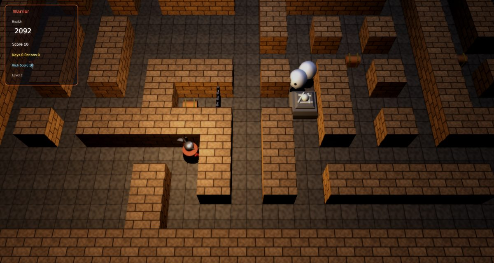

# Gauntlet Remix

A faithful modern remake of Atari's **Gauntlet** (1985) for [Phasma Engine](https://github.com/christoskaramou/PhasmaEngine).
Choose Thor the Warrior, Thyra the Valkyrie, Merlin the Wizard or Questor the Elf and fight down through the dungeon.

## Highlights
- **The four heroes, each with their own stats**:
  - Warrior: strongest shot and melee, but slow.
  - Valkyrie: best armour.
  - Wizard: strongest magic, so his potions also wreck generators.
  - Elf: fastest, with quick arrows.
- **Gauntlet rules**:
  - Health starts at 2000 and drains 1 point a second. Food restores 100 (and shooting food destroys it).
  - "Needs Food Badly" appears below 200.
  - Keys open a whole run of connected doors.
  - Potions destroy every monster on screen. Shooting a potion sets off a weaker blast.
  - Treasure is worth 100 points.
- **Generators** keep spawning monsters while you're near, so destroy them first. Each generator has a level from 1 to
  3, shown by its size: higher-level generators spawn tougher monsters and take more hits, and they drop a level as
  they're damaged.
  - Ghosts hit once and vanish.
  - Grunts and demons club you, and demons also spit fireballs.
  - Lobbers throw rocks over walls to where you're standing.
  - Sorcerers blink invisible, and shots pass through them while they're invisible.
  - From level 6, Death appears. He drains up to 200 health, and only a potion destroys him (1000 points).
- **Levels**: 20 fixed dungeon floors, each generated from a fixed seed so it plays the same every time, then the
  dungeon loops as "Round 2", "Round 3"… with tougher generators, faster spawning and Death arriving sooner.
  - Six layout styles, so floors look and play differently: braided mazes, halls (rooms joined by corridors), pillared
    colonnades, concentric rings, mirrored mazes and slanted (diagonal) walls. Sizes run from 29×21 to 41×29, the start
    moves around the map, and every floor has its own wall/floor texture and tint.
  - **Treasure Rooms** (floors 5, 10, 15, 20): no monsters, chests everywhere and a countdown. Reach the exit for a time
    bonus; if the clock runs out you're sent on without it.
  - **Exit to level N**: some floors (4, 9, 12, 16) have a second, gold-framed exit that skips ahead 2–4 floors. A banner
    tells you where it leads when you get close.
  - **Trap tiles** (from floor 3): stepping on one makes every trap wall on the floor crumble, opening shortcuts and
    sealed treasure alcoves.
  - **Stun tiles** (from floor 4): a jolt that freezes the hero for 0.8 s.
  - Doors only guard treasure alcoves. Every floor is checked at build time so that the exit (and any skip-ahead exit) is
    reachable with all doors, trap walls and generators treated as solid, so a floor can always be finished.
- **Modern 3D look without neon**: brick walls and flagstone floors that change colour every level, a flickering torch
  light that follows the hero, chests, food, potions, keys and bone-pile generators.
- **Detailed, animated characters** that stay close to the arcade designs:
  - Heroes: the horned-helm Warrior with his axe, the winged-helm Valkyrie with sword and shield, the robed Wizard with
    his pointed hat and staff, and the Elf in a hood with a bow and quiver.
  - Monsters: the sheet Ghost, club-carrying Grunt, winged Demon, hunched Lobber, hooded Sorcerer and robed Death with his scythe.
  - Every model is a jointed rig (about 37k triangles in total) with its own materials. It walks, swings when it
    attacks, leans into turns and idles. Ghosts float with their arms out, the Demon flaps, and the Sorcerer and Death
    hover.
  - Generated by `tools/gen_chars.py`.
- **Effects**: hero-coloured muzzle flashes, fireball trails, smoke puffs on kills and spawns, sparks on melee, dust on
  impacts and footsteps, and the shared explosion preset (fireball, sparks, embers, smoke, debris) for generators and
  potions. Particles use `Assets/Scripts/Lib/particles.lua`, an unmodified copy of the shared helper, through `tools/src/02c_fx.lua`. The textures in `Assets/Textures/fx/` are premultiplied copies made by `tools/gen_fx_pm.py`. The engine's particle pass screen-blends and ignores texture alpha, so without premultiplying, soft sprites draw as hard discs.
  - Render settings: TAA on, CAS off (HDR off), soft bloom (strength 0.55).
- **Movement and collision**:
  - Movement is 8-way. Walls are checked one axis at a time, so a diagonal into a wall slides along whichever direction
    is open.
  - **Corner assist**: the hero's collision circle is a little smaller (0.29). When a straight move is blocked by a
    corner, the hero is nudged sideways toward the open lane, by up to 0.45 of a tile, so you no longer stick on wall
    corners. Press F3 to see it.
  - Movement is drawn interpolated between 60 Hz steps, so motion stays smooth at any refresh rate.
  - Monsters chase in 8 directions and step around corners.
  - Shots are swept in small steps against walls, doors, generators and monsters.
- **F3 collider overlay**: shows wall edges facing the floor, doors, generators, the hero and monster circles, shot
  paths, enemy shots and items.
- **Fixed 60 Hz simulation** with capped catch-up (40-144 FPS). Mouse-clickable title (with hero selection), pause,
  game over and settings menus. The cursor is hidden while you play.

## Controls
| Key | Action |
|---|---|
| WASD / Arrows | Move (8 ways). Walk into monsters or generators to fight them. |
| Space / J / Left Click | Shoot (one shot per press) |
| Shift / X / Right Click | Use a potion |
| 1-4 / Left / Right (title) | Choose your hero |
| P / Esc | Pause |
| O | Settings |
| M | Mute |
| F3 | Collider overlay |

## Run
`run.cmd` or `run.ps1` (Windows). Levels, meshes, textures and sounds are generated by `tools/` (levels.py, gen_meshes.py, gen_assets.py, gen_tex2.py). The music is original.
