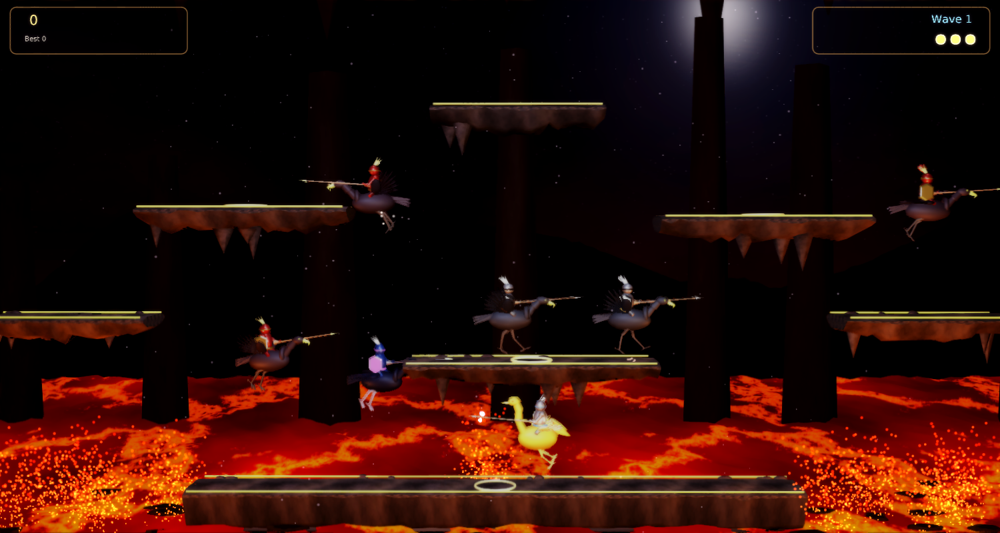
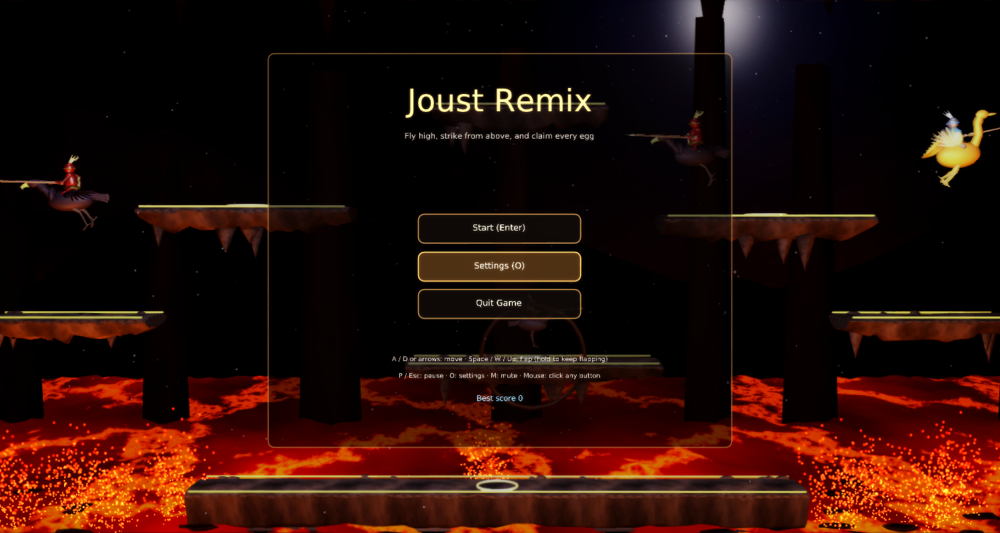
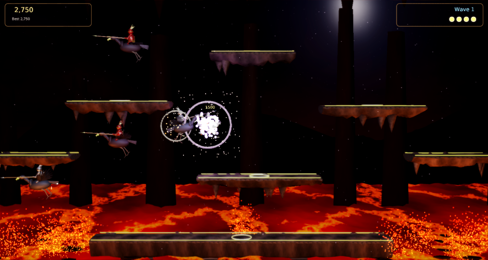
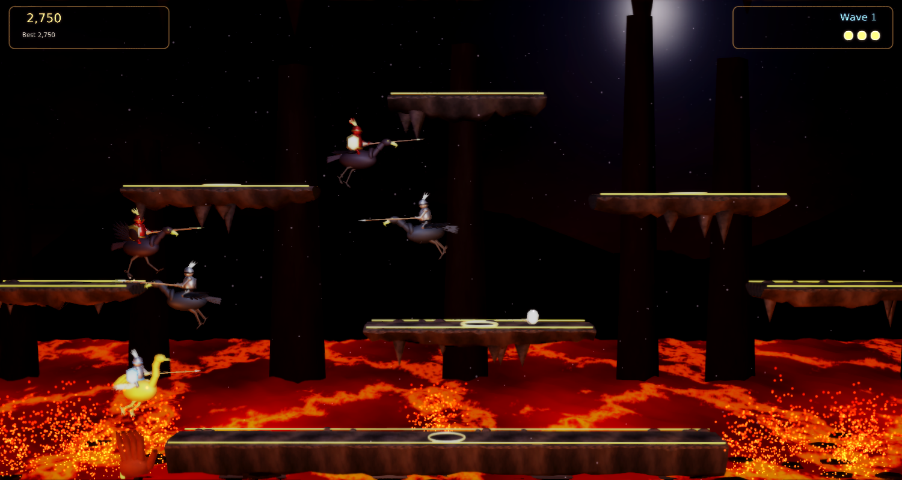

# Joust Remix

A modernized remake of Williams' **Joust** (1982) for
[Phasma Engine](https://github.com/christoskaramou/PhasmaEngine). Ride your ostrich over a lava lake. Fly high,
unseat the buzzard knights with the higher lance, and collect their eggs before they hatch.

## Highlights
- **Faithful core**: flap-to-fly physics with momentum and a wrap-around arena, ground running with skids, floating
  rock ledges, and four spawn pads. In every clash the higher lance wins, and evenly matched lances bounce apart.
  Unseated knights drop eggs: collect them for 250, 500, 750 and then 1000 points, plus 500 for a mid-air catch.
  An egg left too long hatches into a tougher knight (Bounder, then Hunter, then Shadow Lord).
  From wave 2 a **lava troll** grabs anyone flying low over the lava, and you flap to break free.
  Waves get harder over time. You also get a 3000-point survival bonus, an extra life every 20,000 points,
  and a saved high score.
- **Cooked meshes**: ostrich and buzzard mounts (body, beak and eyes, two animated legs, two flapping wings), and a
  knight (armour, shield and visor trim, glowing plume, lance with a glowing tip), each tinted per enemy class.
  Also rocky ledges with stalactites and glowing rims, a wavy lava surface with drifting crust, eggs with glowing bands,
  the troll hand, cavern ridges and rock pillars. All of these are generated by `tools/gen_meshes.py` and `tools/gen_world.py`
  (degenerate triangles are dropped before cooking), cooked with `PhasmaCook`, and cloned from `.pescene` templates at runtime.
- **VFX and lighting**: animated lava (pulsing emissive, rising embers, flickering heat lights), drifting ash, flap
  puffs, landing and running dust, skid sparks, lance-clash sparks with shock rings, layered unseat explosions with
  tumbling feathers and shards, hatch bursts, spawn columns, and the troll's lava splash. There are also dynamic point lights,
  a volcanic HDR skybox for IBL, and a moonlit sky backdrop.
- **TAA + soft bloom**: `taa` on, `cas_sharpening` off, `fxaa` and motion blur off, `bloom_range` 1.1,
  `bloom_strength` 0.55. See `/workspace/games/common/RENDER_SETTINGS.md`.
- The shared **settings menu** (`Assets/Scripts/Lib/settings_menu.lua`) is mouse-clickable, with volume at 50% by default.
  The title, pause and game-over buttons are mouse-clickable too.

## Controls
| Input | Action |
|---|---|
| Left / Right or A / D | Run / steer in the air |
| Space / W / Up | Flap (hold to keep flapping) |
| P / Esc | Pause |
| O | Settings |
| M | Mute |
| Mouse | Click any menu button |

## Run
`run.cmd` (or `run.ps1`) starts PhasmaPlayer from the newest `PhasmaEngine\build*\Release` build, using a private
runtime folder under `%LOCALAPPDATA%\PhasmaGames\JoustRemix`.

## Screenshots
| | |
|---|---|
|  |  |
|  |  |

## Playtest fixes (Oct 2026): mesh-matched colliders
- Every rider is a compound of tapered capsules taken from the mesh source (`tools/gen_meshes.py`, which the .pemesh files are cooked from). The parts:
  - Mount: body, tail, neck segments, head and beak (separate ostrich and buzzard sets), plus legs.
  - Knight: torso, helmet and plume.
  - Lance: a shaft (mesh x 0.15 to 3.0) and a tip (3.0 to 3.45).
- The colliders follow the rider node's real transform: scale, tilt, and the yaw turn, so the lance flips with facing and sweeps through the turn. Wings (animated feathers) are left out.
- Joust rule kept: any contact (lance tip on a body, lance on lance, body on body) starts a joust. The higher rider wins by more than 0.35; otherwise both bounce.
- Ledges: the top surface is used for landing. Head and side bumps use a simple flat underside at the slab's mean bottom (from `tools/colgen.py`, embedded as `G.PLAT_COL`). Stalactites are decorative and have no collision.
- Fall-through fix: a grounded rider is never pushed by ledge bumps. Before, the knight's helmet/plume touched the ledge above the base while walking, the bump shoved him below the floor and he dropped through. Landing also tolerates a 0.3 dip. Walk tests: 25 s back and forth on all 7 ledges at 144, 20 and 4 FPS with zero support losses.
- Eggs: a capsule matching the egg mesh (0.72 x 0.96), rolling with the egg. You collect an egg when any part of your rider touches it.
- Enemies push apart only when their bodies actually touch.
- **F3** toggles a collider overlay:
  - Green: mount and legs.
  - Blue: rider.
  - Yellow: lance. Red: lance tip.
  - Orange: egg.
  - Cyan: ledges (top surface + flat underside box).
