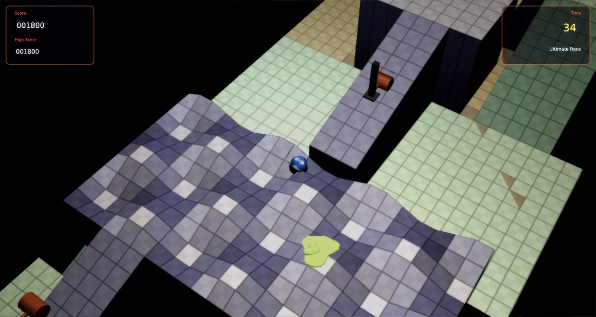

# Marble Madness Remix

A faithful modern remake of Atari's **Marble Madness** (1984) for [Phasma Engine](https://github.com/christoskaramou/PhasmaEngine).
Roll your marble down six isometric races to the goal before the clock runs out.

## Highlights
- **Six races, as on the arcade**: Practice (60 s), Beginner (60 s), Intermediate (40 s), Aerial (40 s), Silly (35 s) and
  Ultimate (35 s). Seconds you don't use carry over into the next race. In the Silly Race gravity is reversed on the
  slopes, so the marble rolls uphill.
- **Real marble physics**: each course is a height field with bilinear interpolation. Slopes accelerate the marble like a
  rolling solid sphere, steps taller than the marble's base act as walls and bounce it back, and edges launch it into the
  air. A long drop shatters it, and falling off the world loses it. The marble comes back at the last checkpoint after
  2 s, and the clock keeps running while it's gone.
- **Hazards**: steelies chase you and knock you around, Marble Munchers hop out to eat you, acid pools slide back and
  forth along their tracks, and hammers slam down on a fixed rhythm.
- **Scoring**: points for every row of progress down the course (more on later races), plus a time bonus at the goal.
- **Modern 3D look without neon**: textured tile courses with walls; slopes are shaded by the way they face (flat tiles brightest, slopes falling away darkest and cooler), like the arcade's isometric shading; a swirled glass marble that rolls with its speed and
  heading, a contact shadow, shatter shards, particles and light flashes, and a dark starry backdrop.
  - Render settings: TAA on, CAS off (HDR off), soft bloom (strength 0.55).
- **Smooth at speed**:
  - The marble, steelies, acid and camera are drawn interpolated between 60 Hz physics steps.
  - Before, the raw step positions were drawn, so the marble moved 0, 1 or 2 steps per displayed frame. TAA smeared that
    uneven motion into blur and visible micro-jumps.
  - The marble's spin is a rotation matrix rolled about (up × velocity) each step. The old roll and heading angles
    flipped 180° whenever the heading reversed.
  - No trembling while the race is frozen: whenever a step doesn't move something (the "Ready" countdown, after the
    goal, time out, while broken), its previous-step position and spin are set to the current ones. Before, the stale
    previous step kept being blended in with a different fraction every frame, so the marble shook on the spot before
    the start and on the goal pad. After the goal line the marble now coasts to a stop on the pad instead of freezing.
- **Safe respawns, no death loops**: a broken marble used to reappear exactly on the last checkpoint, and some
  checkpoints sit inside an enemy's reach (Aerial Race: the snake-like Marble Muncher coils 1.1 m from one; Ultimate
  Race has munchers 0.5-1 m from two and an acid slime crossing another), so it died again on arrival, forever.
  Now the marble comes back at the most recent spot where it was rolling safely, or else near the latest checkpoint
  at a point that is solid, has no edge within 0.9 m, can roll on to the checkpoint, and is clear of every hazard's
  reach. Each candidate is test-rolled for 3.5 s with no input using the real physics, and is rejected if an idle
  marble would roll off, shatter, or drift into a hazard. If a checkpoint has no such point, the previous one is used.
  Munchers and steelies near the respawn are sent home. For 2.5 s afterwards the marble blinks and is invulnerable:
  munchers, acid and hammers can't kill it, steelies pass through it, and enemies don't chase it. Falling off an
  edge still counts.
- **New game starts clean**: every course except the current one is hidden. Before, the previous race's course stayed
  visible after a new game, and its funnel buried the Practice start platform.
- **Effects**: glass chips, glints and dust when the marble shatters, sparks on bumps, dust on landings and hammer
  slams, and green vapour from acid. Particles use `Assets/Scripts/Lib/particles.lua`, an unmodified copy of the shared helper, through `tools/src/02c_fx.lua`. The textures in `Assets/Textures/fx/` are premultiplied copies made by `tools/gen_fx_pm.py`. The engine's particle pass screen-blends and ignores texture alpha, so without premultiplying, soft sprites draw as hard discs.
- **F3 collider overlay**: shows the marble and its footprint, steelie, muncher, acid and hammer hit areas, wall edges
  near the marble, checkpoints (green once you've passed them) and the goal.
- **Fixed 60 Hz simulation** with capped catch-up (40-144 FPS). Mouse-clickable title, pause, game over and settings
  menus. The cursor is hidden while you play.

## Controls
| Key | Action |
|---|---|
| WASD / Arrows | Push the marble. Diagonals push diagonally, relative to the screen. |
| Mouse | Trackball: flick to push. |
| P / Esc | Pause |
| O | Settings |
| M | Mute |
| F3 | Collider overlay |

## Run
`run.cmd` or `run.ps1` (Windows). Courses, meshes and sounds are generated by `tools/` (courses.py, gen_meshes.py, gen_assets.py).
