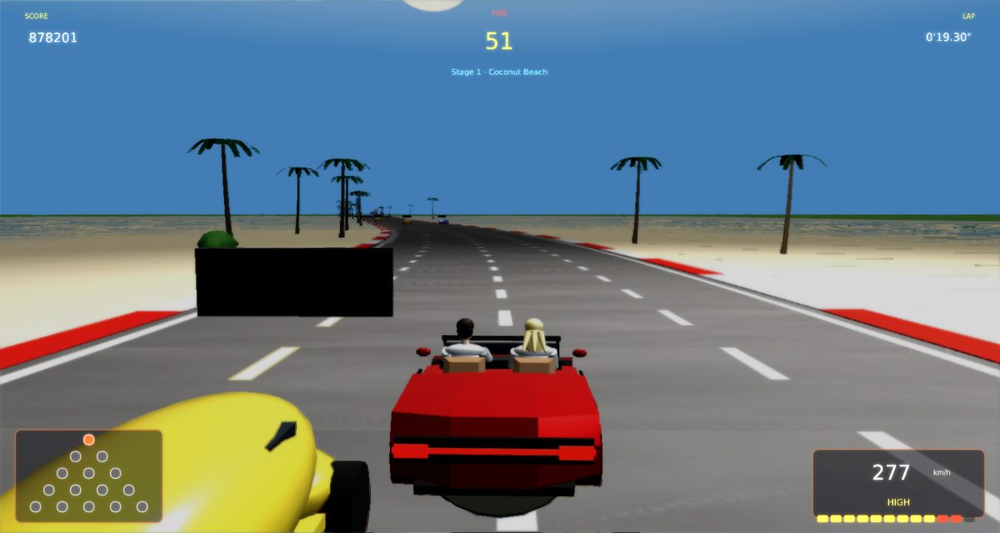

# Out Run Remix

A faithful modern remake of Sega's **Out Run** (1986) for
[Phasma Engine](https://github.com/christoskaramou/PhasmaEngine). Drive the red convertible across five stages, pick a
road at every fork, and reach one of the five goals before the timer runs out.

## Highlights
- **The original 15-road map.** Coconut Beach forks into Gateway or Devil's Canyon, then Desolation Hill, Alps or
  Cloudy Mountain, then Wheat Field, Seaside Town, Old Capital or Wilderness, and finally Vineyard, Death Valley,
  Desert, Autobahn or Lakeside. These lead to Goals A to E. The course map in the corner shows the route you've taken.
- **Real forks in 3D.** Near the end of each stage the road splits in two, with a planted median between the branches.
  Stay on either side to choose. The road names show up as you approach the split.
- **Original flow.**
  - You start with 75 seconds. Each checkpoint arch adds time (64, 62, 60 and 58 s) and shows "Extended Play!".
  - Lap times are recorded for each stage. At the goal you get a time bonus for the seconds left.
  - When the time runs out, the driver brakes hard and the car pulls up on the spot (collisions stay on), then the game
    is over.
- **Original handling.**
  - Two gears: Low tops out at 190 km/h and accelerates hard, High reaches 293 km/h. Pulling away in High is sluggish.
  - Curves push the car outwards at speed. Off-road surfaces slow you down.
  - Hitting a roadside object makes the car tumble and stop you. Clipping traffic at a big speed difference makes you
    spin out.
  - Score builds with speed.
- **Traffic**: Beetles, Corvettes, cabs and box trucks, with brake lights. There's more traffic on the town and
  Autobahn stages.
- **Scenery for every road**: palms and beach, ruined columns, canyon cliffs, snowy pines, windmills and wheat fences,
  town blocks and street lamps, vineyards, cacti and lakeside forest. Each road has its own ground and horizon
  panorama. There are curve warning signs, plus Start, Checkpoint and Goal gantries with a flagman.
- **Radio**: choose one of three tracks on the title screen with Left / Right or the Radio button. The tunes are
  original compositions in the spirit of the arcade game, not Sega's tracks.
- **Modern look without neon**: lit 3D models, sun and fill lights that follow the car, a horizon ring with distant
  scenery, tyre smoke, crash debris and camera shake.
  - Render settings: TAA on, CAS off (HDR off), soft bloom (strength 0.55, range 1.2).
- **Fair collisions**: the car's hit box matches its body, and objects use their trunk or base width, not their
  leaves. The collision window is longer than the distance travelled in one step, so nothing is skipped even at top speed.
  Press **F3** to show the road edges, the car, traffic and object colliders.
- **Power slides that look right**: in a hard bend the nose points into the curve and the tail swings out, with the front
  wheels counter-steering. Before, the steering yaw had the wrong sign, so the nose pointed out of the bend.
- **Particle effects** (the shared `particles.lua` helper with premultiplied textures, for the engine's screen-blended
  particle pass):
  - Tyre smoke from both rear wheels in slides, hard cornering, heavy braking and spins.
  - Off-road dust in the ground's colour (sand, grass clippings, snow, earth), with thrown grit.
  - Exhaust puffs from the twin pipes, plus a flame pop on every gear change.
  - Crash: sparks, shattered glass, a dust ring, tumbling body and trim shards (real meshes), and smoke pouring off the
    wreck.
- **No z-fighting**:
  - The road and ground bodies sit below their surface quads.
  - Each overlapping segment piece (road, kerbs, ground slabs) sits on its own millimetre layer.
  - Fork road B sits a layer above road A, and the inner kerbs are hidden while the two roads still overlap.
- **No grass over the road**:
  - The far plane that fills the view beyond the ground slabs stays under the lowest road in view. It used to sit just
    under the road at the car, so every downhill ahead disappeared under a flat green band.
  - The last fork segment ends at its own road's end point, not at the next road's start 46 m to the side, which used
    to skew one ground slab across the road ahead at every stage change.
  - `tools/check_ground.lua` checks every ground slab and the far plane against every road quad in view on all 16
    routes (0 problems now; the old rules failed at 34,626 camera positions).
- **Fixed 60 Hz simulation** with capped catch-up, so the car drives the same at 40 to 144 FPS.
- **Mouse-clickable menus**: title, pause, goal and game over cards, and the shared settings menu. The cursor is hidden
  during play.

Notes: the time limits, scoring and bonus values follow the arcade game closely but aren't exact. The stage lengths
and layouts are a recreation of each road's character, not a copy of the original track data.

- **No scenery on the road at the forks**: roadside objects were placed from the unsplit centre line, but inside a
  fork the two roads slide out to +-46 m, straight over that scenery. Palms, columns and rocks ended up on the road
  about a minute in, at the first fork. Inside a fork every roadside object now rides out with its own branch. Median
  bushes and rocks only appear once the inner kerbs are far enough apart. `tools/check_scenery.lua` builds all 16
  routes and checks every object's footprint against every road, including both fork branches: 215 overlaps before,
  0 after.
- **Deterministic fork choice**: the branch was decided by the car's side at a single segment, and the switch into
  the chosen branch's frame moved the car's position without its previous-step position, which the renderer
  interpolates from. So the car and camera were drawn up to ~21 m sideways for a frame and snapped back. Now the
  pick has hysteresis (you must cross 2.5 m past the centre line to change it) and is shown on the fork sign, where
  the picked road is gold and larger. It locks as soon as the roads have separated and the car is fully on one of
  them, or at the latest 70 segments in. The lock is announced, and the map lights the next road. The frame switch
  moves both positions by the exact interpolated offset, so it is seamless.

## Controls
| Input | Action |
|---|---|
| W / Up | Accelerate |
| S / Down | Brake |
| A / D or Left / Right | Steer |
| Space / Shift / Right Click | Shift gear, Low or High (one shift per press) |
| Left / Right (title) | Change the radio track |
| P / Esc | Pause |
| O | Settings |
| M | Mute |
| F3 | Collider overlay |
| Mouse | Click any menu button |

## Run
`run.cmd` (or `run.ps1`) searches upward for a `PhasmaEngine` checkout and starts the player with this project.

## Files
- `Assets/Scripts/game.lua`: the whole game. It is built from `tools/src/0*.lua` by `tools/build_lua.sh`.
- `Assets/Scripts/Lib/particles.lua`: the shared particle helper, an unmodified copy, used through `tools/src/02c_fx.lua`.
  `tools/gen_fx_pm.py` writes premultiplied particle textures to `Assets/Textures/fx/`.
- `tools/gen_meshes.py`: generates the meshes. `tools/gen_scene.py` generates the template scene.
  `tools/gen_assets.py` generates the textures, horizon panoramas, skybox, engine sounds and radio tunes.
- `shots/`: screenshots of the title, several stages, a fork, traffic close up, the goal card and the F3 overlay.
