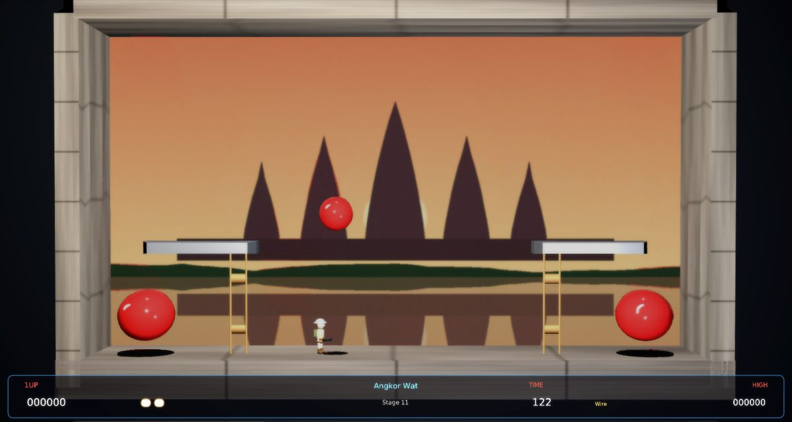

# Pang Remix

A faithful modern remake of Mitchell's **Pang** (1989, also released as *Buster Bros.*) for
[Phasma Engine](https://github.com/christoskaramou/PhasmaEngine). Fire your harpoon wire straight up, split every
bouncing balloon until none are left, and travel around the world in 50 stages.

## Highlights
- **The original world tour.** 50 stages across the 17 locations of the arcade game, in the original order:
  Mt. Fuji, Mt. Keirin, Emerald Temple, Angkor Wat, Ayers Rock, Taj Mahal, Leningrad, Paris, London, Barcelona,
  Athens, Egypt, Kenya, New York, Maya, Antarctica and Easter Island. Each location has its own painted backdrop.
  - The stage layouts follow the arcade style: open floors first, then steel blocks, breakable glass blocks and
    ladders. The arcade's exact per-stage data isn't publicly documented, so the layouts are recreations rather than
    copies.
- **Original balloon rules.** There are four balloon sizes, and each size always bounces to the same height. A hit
  splits a balloon into two of the next size down, and the smallest size vanishes. Hits score 50, 100, 150 and 200
  from largest to smallest.
  - Each stage has a countdown timer. Warning beeps start at 15 s, and Time Over costs a life. Clearing a stage awards
    a time bonus of 100 points per remaining second.
  - Extra lives at 20,000 points, then 50,000, then every 50,000.
- **Weapons and items**, which drop from popped balloons and broken glass:
  - Double Wire: two wires on screen at once.
  - Power Wire: the hook sticks to the ceiling or a block for 3 s.
  - Vulcan Missile: hold fire for rapid shots.
  - Clock: stops the balloons for 6 s.
  - Hourglass: slows the balloons for 8 s.
  - Dynamite: bursts every balloon down to the smallest size.
  - Shield: absorbs one hit.
  - 1UP, plus fruit worth 500, 1000 and 2000.
- **Crabs and birds**: crabs stun you, and either one gives 500 points when you hit it with a wire.
- **Characters and props**: cooked 3D models.
  - The hero is a safari hunter in a pith helmet, with a harpoon gun. He walks, climbs, fires with the gun held
    overhead, blinks while stunned and spins when he dies.
  - Glossy balloons squash slightly on each bounce and cast shadows on whatever surface is below them.
  - Also zig-zag harpoon wires, the power hook, every item, crabs and birds.
- **Modern look without neon**: painted 1280×720 backdrops, a carved stone frame, soft key and fill lighting,
  pop rings, sparks and point-light flashes, dust, and screen shake for the big balloons.
  - Render settings: TAA on, CAS off (HDR off), soft bloom (strength 0.55, range 1.2).
- **Fair collisions**: the player's hit box (0.9 × 2.0) is smaller than his mesh, and balloons only hurt inside 90% of
  their radius. Wire and vulcan hits are swept, so fast shots can't pass through a balloon.
  - Press **F3** to show every collider: walls, blocks, ladders, the player, balloons, wires, items and animals.
- **Fixed 60 Hz simulation** with capped catch-up, so speeds are the same at 40 to 144 FPS.
- **Mouse-clickable menus**: title (with Continue from your furthest stage), pause, game over, and the shared
  settings menu. The cursor is hidden during play.

## Controls
| Input | Action |
|---|---|
| A / D or Left / Right | Walk |
| W / S or Up / Down | Climb ladders. With a diagonal held, the hero takes whichever way is open |
| Space / Z / J / Left Click | Fire (one wire per press; hold for the Vulcan Missile) |
| P / Esc | Pause |
| O | Settings |
| M | Mute |
| F3 | Collider overlay |
| Enter / Space / Click | Skip the stage card |
| Mouse | Click any menu button |

## Run
`run.cmd` (or `run.ps1`) searches upward for a `PhasmaEngine` checkout and starts the player with this project.

## Files
- `Assets/Scripts/game.lua`: the whole game. It is built from `tools/src/0*.lua` by `tools/build_lua.sh`.
- `tools/gen_meshes.py`: generates the meshes. `tools/gen_scene.py` generates the template scene.
  `tools/gen_assets.py` generates the backdrops, textures, skybox and sound.
- `shots/`: screenshots of the title, several stages, the stage card, play, the F3 overlay and close-ups.
