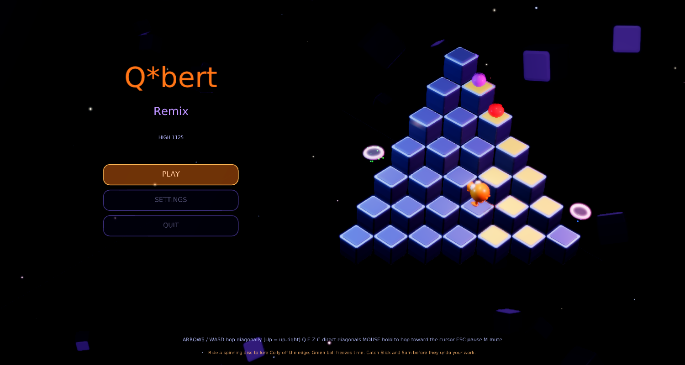
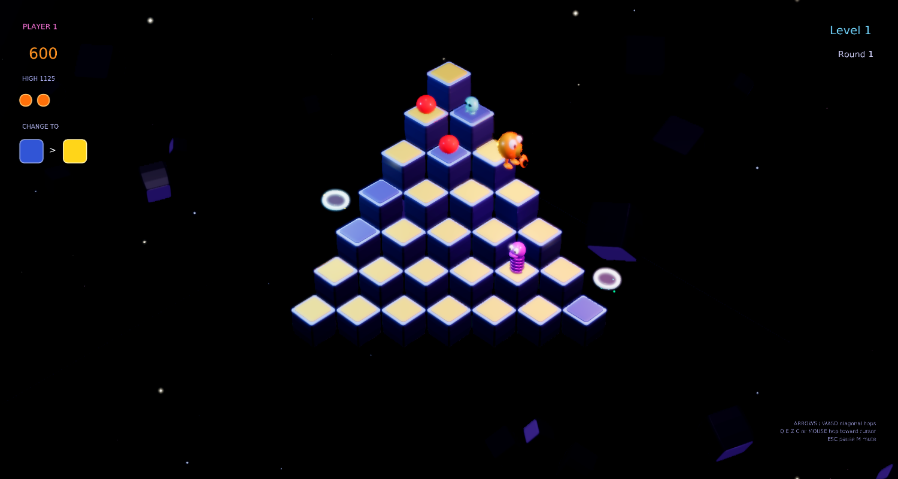
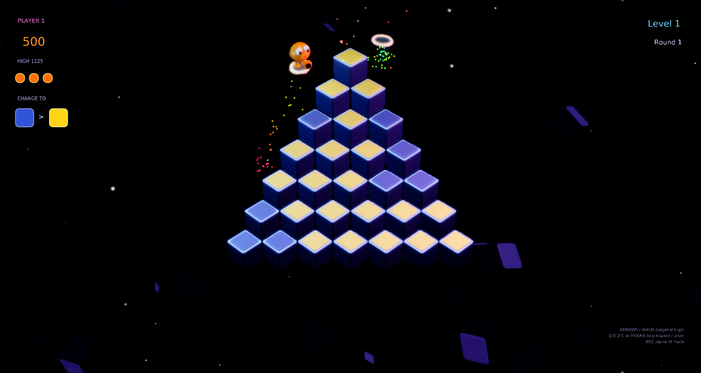
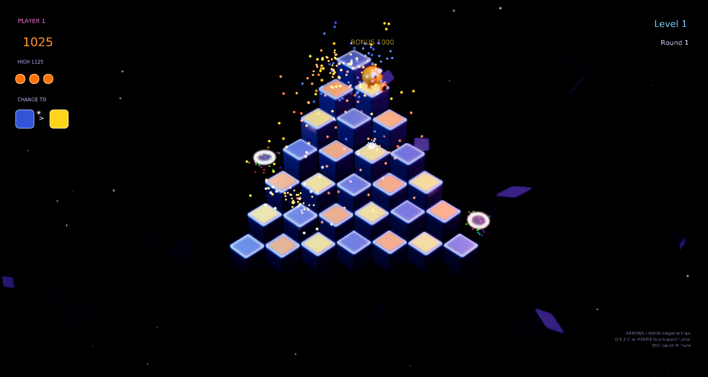

# Q*bert Remix

A modernized remake of Gottlieb's **Q*bert** (1982) for
[Phasma Engine](https://github.com/christoskaramou/PhasmaEngine).



## Highlights
- **Faithful rules**: 28-cube pyramid, diagonal hops change cube tops toward the target colour.
  Level 1 needs one hop per cube, level 2 needs two, level 3 flips cubes back if you hop on them again,
  and level 4+ needs two hops and flips back. 4 rounds per level, each with a new colour theme.
- **Cast**: red balls, the purple ball that hatches into **Coily** (chases you), the green ball (freezes time),
  **Slick & Sam** (undo your colours, catch them for 300), and spinning **escape discs** that lure a nearby
  Coily off the edge (500). Curse balloon `@!#?@!` when you are caught. Extra life at 8,000, then every 14,000.
- **Cooked meshes** (`tools/gen_meshes.py` → `PhasmaCook` → `.pemesh`, cloned from `.pescene` templates):
  bevelled cubes with glowing rims and inset tiles, Q*bert with snout, eyes and feet, Coily's helix spring body,
  glossy balls, Slick & Sam with shades, rainbow escape discs.
- **VFX**: squash & stretch hops, landing dust and tile sparkles, flat shockwave rings, debris shards,
  disc sparkle trails, round-clear confetti with flashing tiles and a pyramid wave, frost sparkles while time is frozen,
  dynamic point lights (Q*bert, Coily, discs, impact flashes), drifting backdrop cubes and twinkling stars.
- **Rendering**: TAA on, CAS sharpening off, FXAA/motion blur off, soft bloom (`bloom_range` 1.2,
  `bloom_strength` 0.5), HDR + tonemapping, dusk HDR IBL.
- Shared **settings menu** (`Assets/Scripts/Lib/settings_menu.lua`): master volume starts at 50%, and every option can be clicked with the mouse.
  Title, pause and game-over menus use clickable buttons.

## Controls
| Input | Action |
|---|---|
| Arrows / WASD | Hop diagonally (Up/W = up-right, Right/D = down-right, Down/S = down-left, Left/A = up-left) |
| Q / E / Z / C | Up-left / up-right / down-left / down-right |
| Mouse (hold left button) | Hop toward the cursor (the quadrant around Q*bert) |
| Esc / P | Pause menu (Resume / Settings / Quit to title) |
| M | Mute |

Taps during a hop are buffered and held keys repeat, so movement stays smooth at any frame rate.

## Run (Windows)
```powershell
.\run.ps1          # or double-click run.cmd
```
This needs a local Phasma Engine build at `../../../PhasmaEngine/build*/Release/PhasmaPlayer.exe`, relative to this folder.
`run.ps1` copies the player into `%LOCALAPPDATA%\PhasmaGames\QbertRemix`, so the editor's settings are never touched.

## Regenerating assets
- `tools/gen_meshes.py` writes the OBJ files, and `tools/cook_all.sh` cooks them into `Assets/Objects/*.pemesh`.
- `tools/gen_assets.py` writes the dusk HDR sky, the backdrop texture and the WAV sound effects.
- `tools/gen_scene.py` writes the template scene.

## Screenshots
| | |
|---|---|
|  |  |
|  |  |
