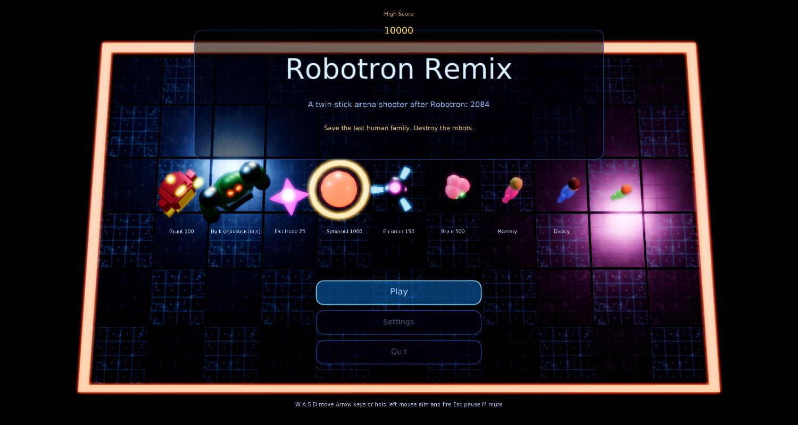
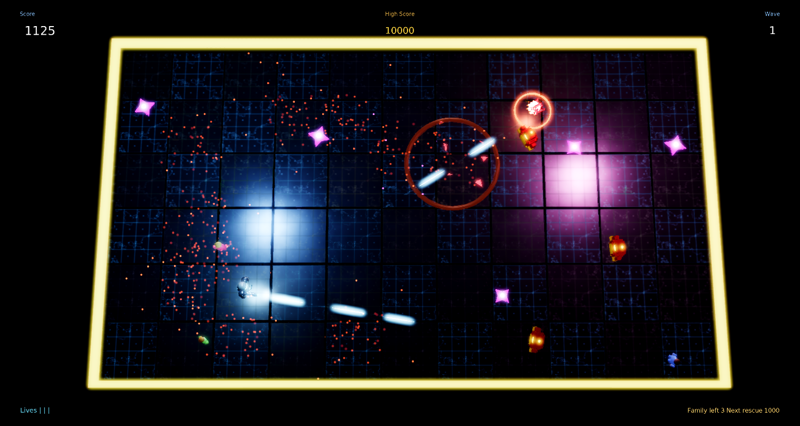
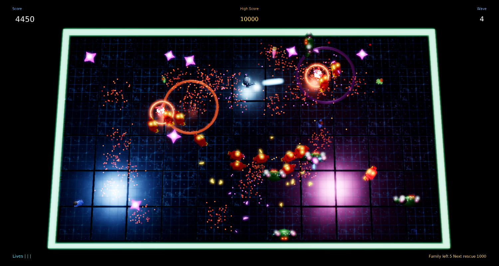
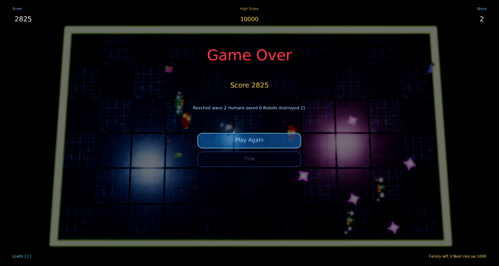

# Robotron Remix

A modernized remake of Williams' **Robotron: 2084** (1982), the original twin-stick arena shooter, for
[Phasma Engine](https://github.com/christoskaramou/PhasmaEngine), written in Lua.

## Run
- Windows: `run.cmd` (or `powershell -File run.ps1 [-Api vulkan|dx12]`). Uses the newest
  `..\..\..\PhasmaEngine\build*\Release\PhasmaPlayer.exe` with a private runtime copy in `%LOCALAPPDATA%\PhasmaGames\RobotronRemix`.

## Controls
| Action | Input |
|---|---|
| Move | W A S D or Arrow keys |
| Aim | Mouse: the hero always faces the cursor (projected onto the arena floor) |
| Fire | Left mouse button (hold for auto-fire); Space also fires toward the cursor |
| Pause menu | Esc or P |
| Mute | M |
| Menus | Mouse hover/click, or Up/Down + Enter |

## Gameplay
- One hero in a walled arena against waves of robots that warp in around you.
- **Grunts** (100) home in on you and speed up the longer a wave lasts. **Electrodes** (25) are static hazards.
- **Hulks** cannot be destroyed: shots only push them back, and they crush any human they reach.
- **Spheroids** (1000) roam the arena and release **Enforcers** (150), which drift toward you and fire.
- **Brains** (500) appear on every fifth wave and later; they hunt the family and fire at you.
- Rescue the last human family (Mommy, Daddy, Mikey) by touching them: 1000, 2000, 3000, 4000, then 5000 per rescue each wave.
- A wave ends when every Grunt, Spheroid, Enforcer and Brain is gone. Extra life every 25,000. You start with 3 spare lives.

## Tech / visuals
- Cooked 3D characters (hero, Grunt, Hulk, Electrode, Spheroid, Enforcer, Brain, and the family) are built
  procedurally by `tools/gen_meshes.py`, cooked with PhasmaCook, held as template nodes in `main.pescene` and cloned at runtime.
- Circuit-panel floor with emissive seams and traces, and arena rails that slowly cycle colour (a nod to the arcade border).
- Warp-in materialisation for every robot, layered explosions (core flash, fireball, sparks, embers, bouncing debris,
  floor shockwave ring, light flash), hero jet particles, a muzzle light, dynamic fill lights and screen shake.
- HDR + TAA + smooth bloom (`hdr=true, taa=true, bloom_strength 0.55, bloom_range 1.8`).
- Shared settings menu: volume (default 50%), SFX, mute, quality, bloom, AO, particles, shake, FPS. Every option is mouse-clickable.
- Assets regenerate with `tools/gen_meshes.py`, `tools/gen_assets.py` (floor textures, HDR sky, WAV sfx) and `tools/gen_scene.py`.

