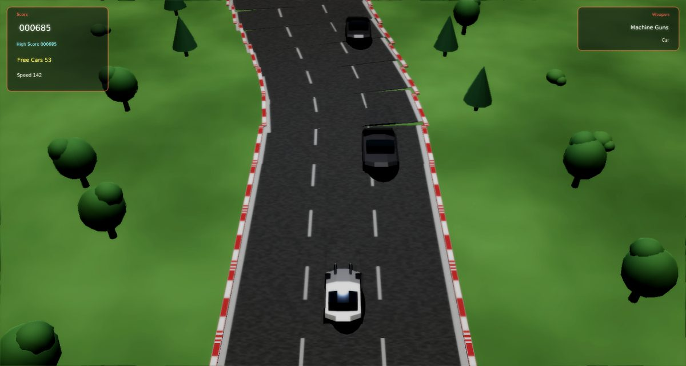
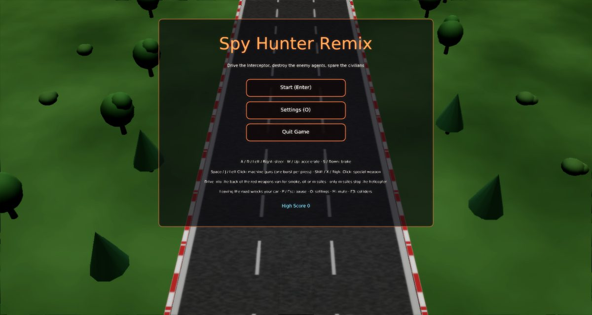
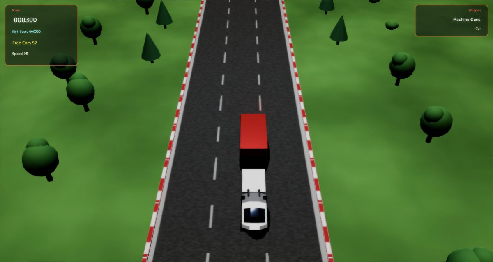
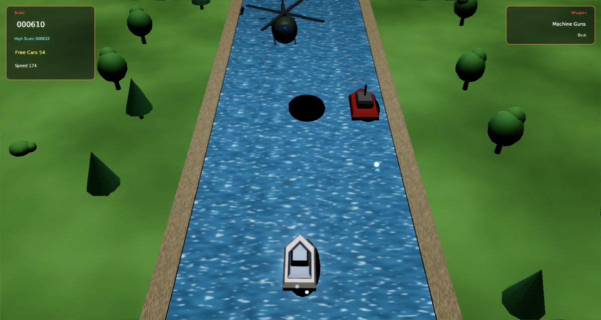
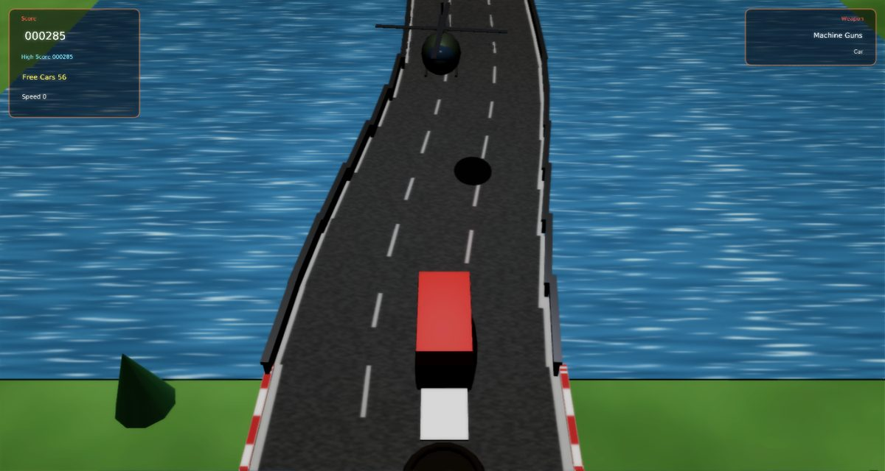
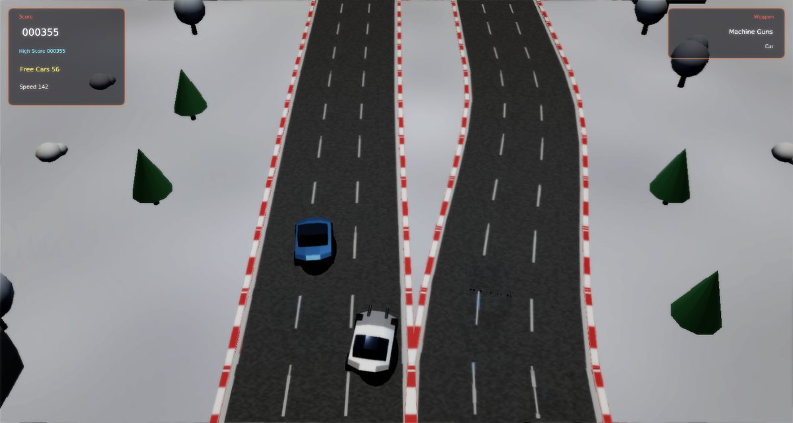
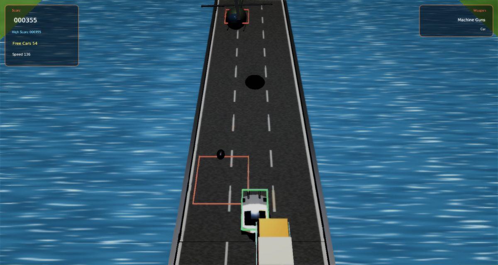

# Spy Hunter Remix

A faithful modern remake of Bally Midway's **Spy Hunter** (1983) for [Phasma Engine](https://github.com/christoskaramou/PhasmaEngine).
Drive the G-6155 Interceptor down an endless road and river, destroy the enemy agents and spare the civilians.

## Highlights
- **Spy Hunter rules**:
  - For the first 60 seconds every lost car is replaced for free (the "Free Cars" timer). After that you play on spare
    cars, and you earn an extra one every 10,000 points.
  - You score points for distance driven. Destroying a civilian car or truck freezes your score for 6 seconds.
  - Drive off the road (or the river) and the car is wrecked.
- **Enemy agents**:
  - Switch Blade: pulls alongside and slashes your tyres with its hub blades.
  - Road Lord: bulletproof, so ram it off the road.
  - Enforcer: pulls alongside and fires sideways.
  - Mad Bomber helicopter: drops bombs ahead of you. Only missiles can bring it down.
  - On the river: Doctor Torpedo's boats and barrel-dropping boats.
- **Weapons van**: the red truck comes along from time to time. Drive up the ramp at its back and you leave with a
  special weapon (smoke screen, oil slick or missiles, in turn).
- **Car and boat**: the road leads to a boathouse dock where the Interceptor turns into a speedboat, and back again
  further on. The road splits around islands, crosses bridges and changes season every lap (summer, autumn, winter
  with snow, spring).
- **Modern 3D look without neon**: textured asphalt with kerbs, water, sand banks, trees, pines, houses and a
  boathouse; modelled vehicles with spinning rotors and wheels.
- **Effects**:
  - Muzzle flashes with a light flash and ejected brass.
  - Explosions: fireball, sparks, embers, rolling smoke and burning debris. A wreck keeps burning on the road for a
    moment. Over water you get a spray column and a foam ring instead.
  - Boat wakes: flat foam V-wakes, bow spray and prop wash for you and the enemy boats, and bubble trails behind
    torpedoes.
  - Tyre smoke under hard braking and sharp steering, and from cars spinning out.
  - Missile flame and smoke trails, and smoke wisps from bomb craters.
  - The oil slick spreads out with a rainbow sheen. The smoke screen is a rolling wall across its whole catch width.
  - Dock: a splash-down when you enter the river, and water streaming off the car on the ramp.
  - Particles use `Assets/Scripts/Lib/particles.lua`, an unmodified copy of the shared helper, through `tools/src/02c_fx.lua`. The textures in `Assets/Textures/fx/` are premultiplied copies made by `tools/gen_fx_pm.py`. The engine's particle pass screen-blends and ignores texture alpha, so without premultiplying, soft sprites draw as hard discs.
- **Spawns always land on the road**:
  - New games, respawns after a crash, and the title attract drive all use a lane that stays clear for the protected
    roll-out ahead.
  - Before, the respawn used the course centre line, which is the grass median wherever the road splits around an
    island. The protection timer then kept pulling the car back onto it.
- **Clean car ↔ boat swap**:
  - The swap is keyed to the vehicle's leading edge, and the dock is valid ground for both vehicles.
  - Before, it switched on the vehicle's centre, while the off-road test checks the corners. The car's nose reached
    the river, or the boat's bow reached the road, while still in the old mode, so a clean run through the dock crashed
    or "drowned" you.
  - The boat now settles into the water with a dip, and the car rises onto the ramp.
  - Render settings: TAA on, CAS off (HDR off), soft bloom (strength 0.55).
- **Collisions**: every vehicle has a box that matches its body. Bullets and missiles are swept, so they can't skip
  past a car. Bumping trades sideways shoves, and an enemy pushed off the road is wrecked (you get the points).
- **F3 collider overlay**: shows road edges, vehicle boxes, shot paths, bombs and drops.
- **Fixed 60 Hz simulation** with capped catch-up (40-144 FPS). Mouse-clickable title, pause, game over and settings
  menus. The cursor is hidden while you play.

## What is approximated
The arcade's exact course layout, point values and enemy timings are not documented, so they are approximations in
the arcade's spirit:
- the course is a hand-made looping sequence of road, island splits, bridges, a dock and river sections;
- the point values (5 per unit driven; 500 for Switch Blade, Road Lord and Enforcer; 700 for boats; 1500 for the
  helicopter);
- the weapons van turns up every 700-900 units, and the helicopter every 500-700.

The music is original. The licensed theme used in the arcade is not included.

## Controls
| Key | Action |
|---|---|
| A / D / Left / Right | Steer |
| W / Up | Accelerate |
| S / Down | Brake |
| Space / J / Left Click | Machine guns (one burst per press) |
| Shift / X / Right Click | Special weapon (smoke, oil or missiles) |
| P / Esc | Pause |
| O | Settings |
| M | Mute |
| F3 | Collider overlay |

## Run
`run.cmd` or `run.ps1` (Windows). Meshes, textures and sounds are generated by `tools/` (gen_meshes.py,
gen_assets.py).

## Screenshots
| | |
|---|---|
|  |  |
|  |  |
|  |  |
