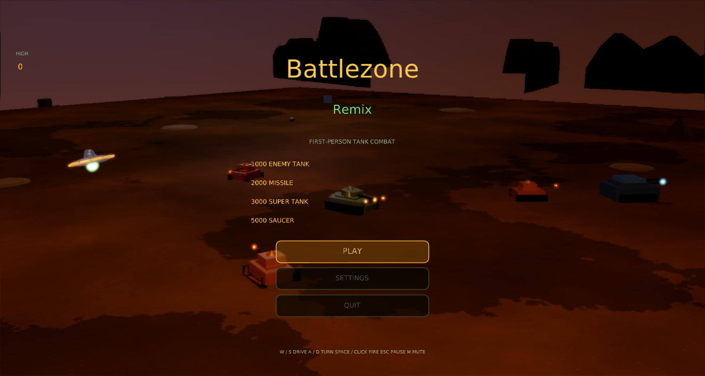
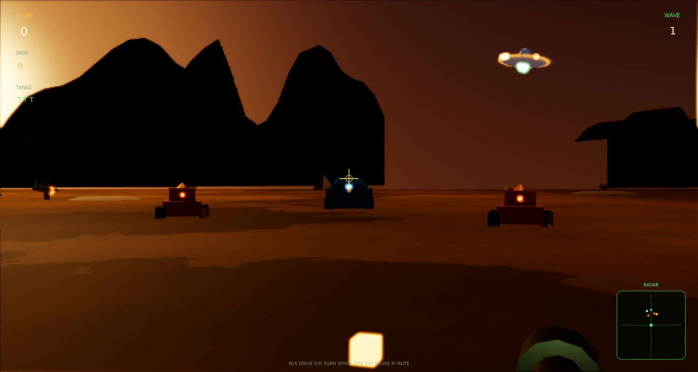
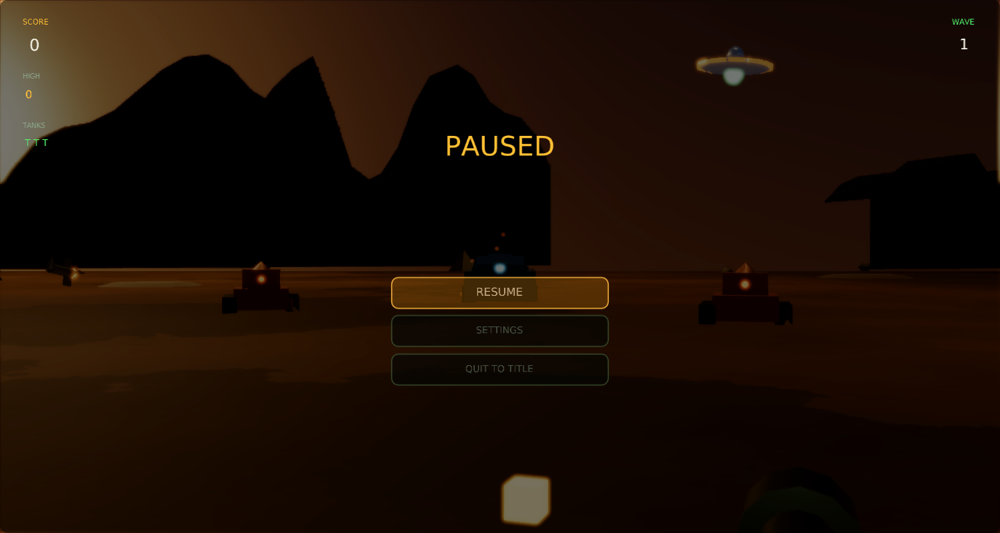
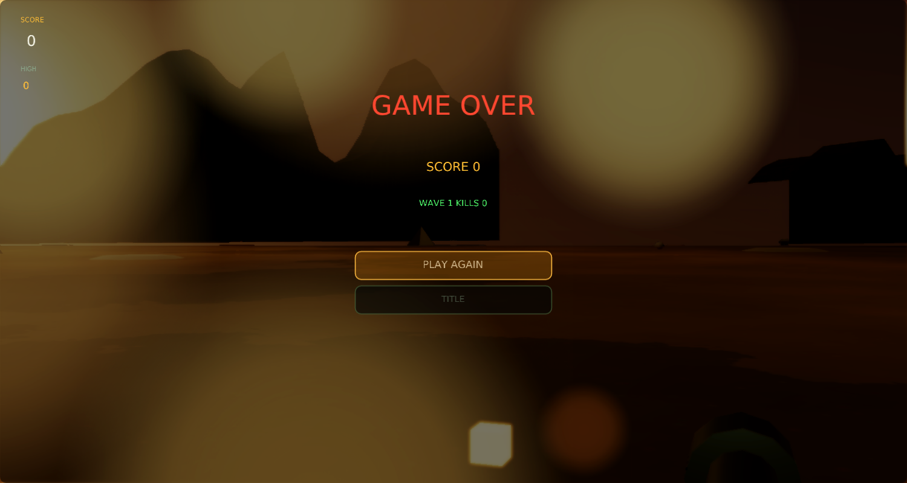

# Battlezone Remix

A modernized remake of Atari's **Battlezone** (1980) for
[Phasma Engine](https://github.com/christoskaramou/PhasmaEngine) — first-person tank combat
on a wasteland plain with cooked meshes, radar, and soft HDR bloom.



## Highlights
- **Faithful FP tank core**: drive and turn with W/S and A/D, fire shells, survive waves of
  enemy tanks, super tanks, guided missiles and flying saucers. Radar, reticle, lives and score.
- **Cooked meshes**: player / enemy / super tanks (hull, treads, turret, barrel, glow), saucer,
  missile, shell, mountain silhouettes, pyramids, rocks, craters — generated by `tools/gen_meshes.py`,
  cooked with `PhasmaCook`, cloned from `.pescene` templates at runtime.
- **VFX**: muzzle flash, dust kicks, layered explosions (fire, sparks, debris shards, shock rings),
  dynamic point lights, desert-dusk HDR IBL sky.
- **HDR + TAA + smooth bloom** (`hdr=true`, `taa=true`, `cas_sharpening=false`,
  `bloom_strength` 0.55, `bloom_range` 1.5).
- Shared **settings menu** (`Assets/Scripts/Lib/settings_menu.lua`): master volume defaults to 50%,
  every option mouse-clickable. Title / pause / game-over buttons are mouse-clickable.

## Controls
| Input | Action |
|---|---|
| W / S or Up / Down | Drive forward / reverse |
| A / D or Left / Right | Turn |
| Mouse X | Fine turn |
| Space / Click | Fire |
| Esc / P | Pause menu |
| M | Mute |

## Run (Windows)
```powershell
.\run.ps1          # or double-click run.cmd
```
Needs a local Phasma Engine build at `../../PhasmaEngine/build*/Release/PhasmaPlayer.exe`
relative to this folder. `run.ps1` copies the player into `%LOCALAPPDATA%\PhasmaGames\BattlezoneRemix`.

## Regenerating assets
`tools/gen_meshes.py` → OBJ → `tools/cook_all.sh` (PhasmaCook) → `Assets/Objects/*.pemesh`.
`tools/gen_assets.py` builds the wasteland HDR sky, ground/rock textures and WAV sfx.
`tools/gen_scene.py` rewrites `Assets/Scenes/main.pescene` template nodes.





## Playtest fixes (Oct 2026): controls
- W / S drive forward and back. The keyboard no longer turns the tank (A/D and the Q/E/Shift precise turn were removed).
- Turning is mouse-only and smoothed: each frame's mouse movement sets a target turn rate, and the tank eases toward it in about 60 ms. Uneven mouse reports and frame times don't cause steps or jitter, and the result is frame-rate independent (verified at 144, 30 and 20 FPS). The default is 300 px/s ≈ 38°/s.
- Settings > Controls > Mouse Sensitivity slider (0.25x to 1.75x, saved with your settings).
- The cursor is hidden and locked (relative mouse mode) only during play. It comes back in the title, pause, settings and game-over menus so buttons stay clickable.
- Space or a left click fires; Esc / P pauses.
