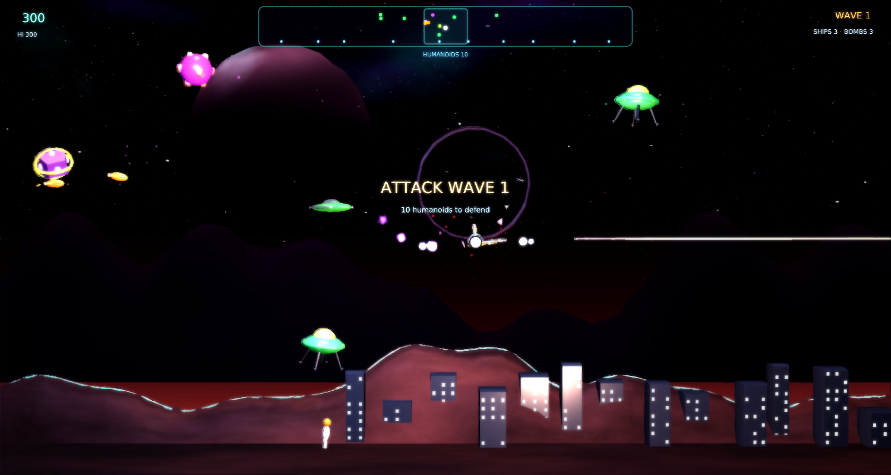
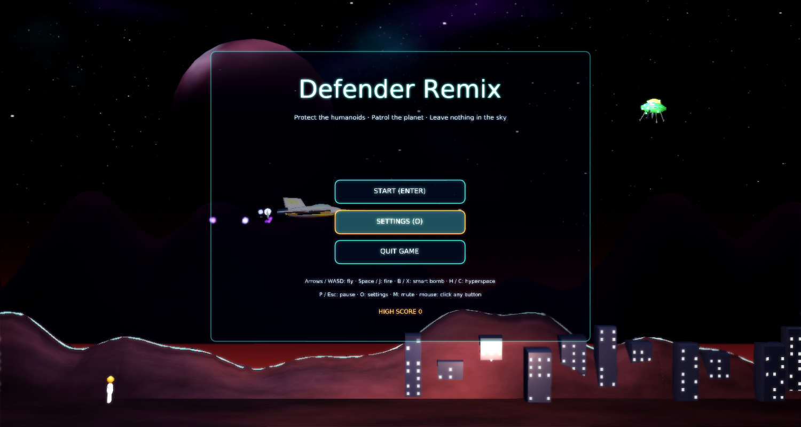
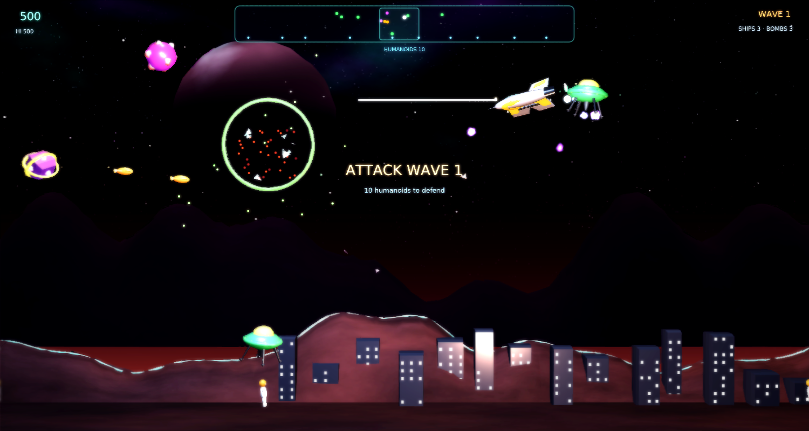
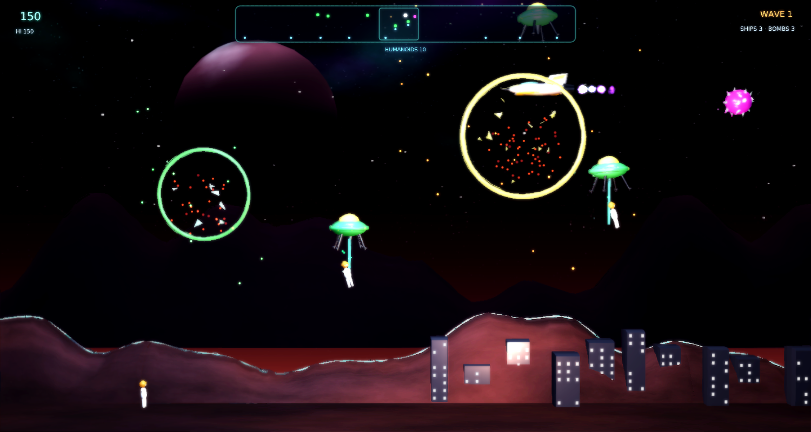

# Defender Remix

A modernized remake of Williams' **Defender** (1981) for
[Phasma Engine](https://github.com/christoskaramou/PhasmaEngine). Patrol a wrap-around planet,
stop the Landers from carrying off the humanoids, and leave nothing in the sky.



## Highlights
- **Faithful core**: a 480-unit wrap-around world with inertial side-scrolling flight and a look-ahead camera,
  a long-range **scanner**, **Landers** that abduct humanoids with a tractor beam (shoot the Lander, catch the
  falling humanoid, set them down for 500 points), **Mutants** born when a Lander reaches the top, **Bombers**
  laying mines, **Pods** bursting into **Swarmers**, **Baiters** that hunt slow players, **smart bombs**,
  **hyperspace**, humanoid wave bonus, bonus ship + bomb every 10,000. Lose every humanoid and the planet
  explodes (all Landers turn into Mutants); it is rebuilt every 5th wave.
- **Cooked meshes**: fighter (body / metal / accent / canopy / engine glow), Lander, Mutant, Bomber, Baiter, Pod,
  Swarmer, humanoid astronaut, mountain ridges with a glowing crest, city blocks with lit windows. All generated by
  `tools/gen_meshes.py`, cooked with `PhasmaCook`, cloned from `.pescene` templates at runtime.
- **VFX + lighting**: aurora sky, ringed-planet backdrop, twinkling stars, parallax far ridge, engine exhaust,
  laser beams with sparks, layered explosions (core flash, fireball, sparks, embers), tumbling debris, shock rings,
  tractor-beam motes, smart-bomb flash, dynamic point lights (engine, lasers, explosions, city glow), dusk HDR IBL.
- **TAA + soft bloom** (`/workspace/games/common/RENDER_SETTINGS.md`): `taa` on, `cas_sharpening` off,
  `fxaa` / motion blur off, `bloom_range` 1.4, `bloom_strength` 0.55, `hdr` on.
- Shared **settings menu** (`Assets/Scripts/Lib/settings_menu.lua`), mouse-clickable, volume 50% by default.
  Title / pause / game-over buttons are mouse-clickable.

## Controls
| Input | Action |
|---|---|
| Left / Right or A / D | Thrust (turns the ship around) |
| Up / Down or W / S | Climb / dive |
| Space / J / Z / Ctrl | Fire (hold for auto-fire) |
| B / X | Smart bomb |
| H / C | Hyperspace |
| P / Esc | Pause |
| O | Settings |
| M | Mute |

## Run (Windows)
```powershell
.\run.ps1          # or double-click run.cmd
```
Needs a local Phasma Engine build at `../../PhasmaEngine/build*/Release/PhasmaPlayer.exe`
relative to this folder. `run.ps1` copies the player into `%LOCALAPPDATA%\PhasmaGames\DefenderRemix`.

## Screenshots
| | |
|---|---|
|  |  |
|  |  |

## Regenerating assets
`tools/gen_meshes.py` → OBJ → `PhasmaCook` (`tools/cook_all.sh`) → `Assets/Objects/*.pemesh`;
`tools/gen_assets.py` (sky, textures, sound effects); `tools/gen_scene.py` (template scene).

## Playtest fixes (2026-10-16)
- **Speed:** ship top speed is now 30 u/s (was 52) with softer acceleration, and vertical speed is 15 (was 24). Enemy shots, mutants, swarmers and baiters are scaled down to match. The simulation runs in fixed 1/60 s substeps, so speed no longer depends on FPS.
- **Lander AI:** landers spawn near the player and drift sideways, picking a new cruise altitude every few seconds (often low, near the surface). They actively hunt humanoids within range: fly over, descend, beam one up and carry it to the top, where it mutates.
- **Laser:** generous vertical hit band (enemy radius + 0.9 around the ship's altitude), swept along the whole beam with extra slack at both ends, so landers at the ship's altitude are hit reliably.
