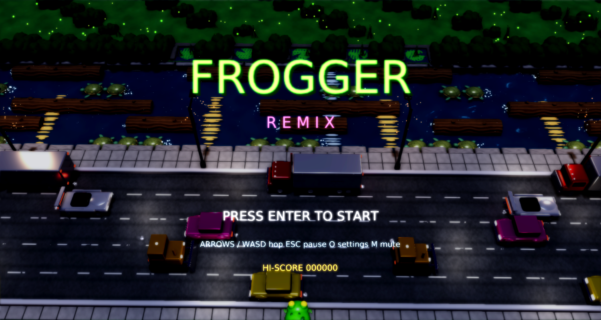

# Frogger Remix

A modernized remake of Konami's **Frogger** (1981) for
[Phasma Engine](https://github.com/christoskaramou/PhasmaEngine), set on a twilight city street.



## Highlights
- **Procedural geometry**: frog (body, belly, spots, eyes, animated legs), sedans, bulldozers,
  racers, trucks with trailers, bark-textured logs with ringed end caps, turtles (scuted shells,
  paddling flippers), lily pads, hedges, street lamps, bonus fly, all generated by
  `tools/gen_meshes.py`, cooked to `.pemesh` with `PhasmaCook` and referenced as template nodes
  in `Assets/Scenes/main.pescene`. The game clones them at runtime with `add_mesh_ref`.
- **Lighting**: a lit 3D road (asphalt with normal map and lane paint), moonlight with shadows, warm
  street lamps, and **dynamic headlights and tail lights** that travel with every vehicle.
- **Glossy river**: real ripple geometry, low-roughness water with a normal map, a flowing (scrolling)
  surface, and shimmering lamp and moon reflections.
- **Bloom** on headlights, tail lights, lamps, the lotus, the fly and the frog's eyes. TAA and motion blur stay off
  because they hide bloom.
- **Particles**: hop dust, water and bark splashes, exhaust, log and turtle foam, diving-turtle
  bubbles, a squash burst (goo, sparks and smoke), home-bay sparkles, level-clear fireworks, river glints,
  fireflies and lamp moths.
- **Faithful rules**: 5 traffic lanes, a safe median, 5 river lanes (logs and diving turtles), five home
  bays, a 40 s timer per frog, 3 lives (+1 at 10,000), 10 pts per new row, 50 + time bonus per frog home,
  +1000 for all five, +200 bonus flies, and each level gets faster (turtles dive more from level 3).
- **Arcade hops**: exactly one hop to the next grid cell per key press (key repeat and presses during a
  hop are ignored; release the key to hop again), 0.17 s animated arcs with squash and stretch, leg
  extension, and a smooth turn to face the hop direction.
- Shared **settings menu** (`Assets/Scripts/Lib/settings_menu.lua`): master volume defaults to 50%.

## Controls
| Key | Action |
|---|---|
| Arrows / WASD | Hop one cell per press |
| Enter / Space | Start / confirm |
| Esc / P | Pause menu (Resume, Settings, Restart, Quit to title) |
| O | Settings |
| M | Mute |

## Run (Windows)
```powershell
.\run.ps1          # or double-click run.cmd
```
Needs a local Phasma Engine build at `../../PhasmaEngine/build*/Release/PhasmaPlayer.exe`
relative to this folder. `run.ps1` copies the player into `%LOCALAPPDATA%\PhasmaGames\FroggerRemix`,
so the editor's `phasma_settings.json` is never touched.

## Regenerating assets
`tools/gen_meshes.py` writes OBJ files, which are cooked with `PhasmaCook in.obj Assets/Objects/name.pemesh`.
`tools/gen_assets.py` writes the textures, HDR sky and WAV files. `tools/gen_scene.py` writes the `.pescene` templates.
