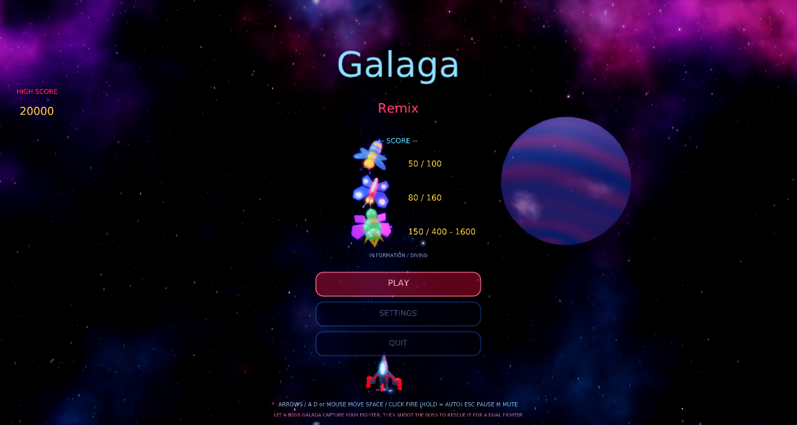
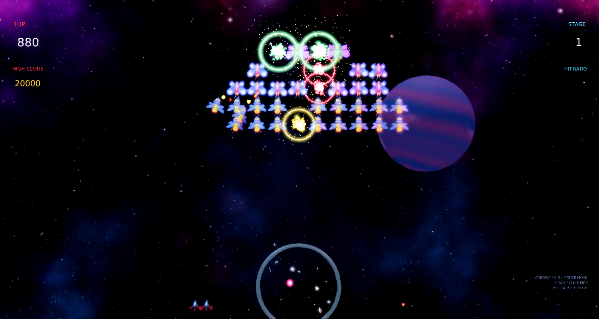
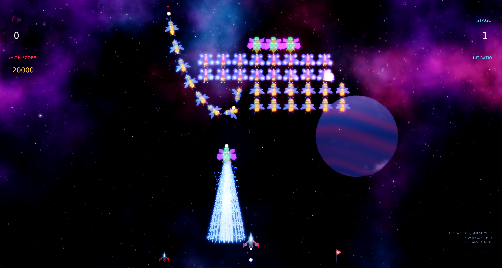
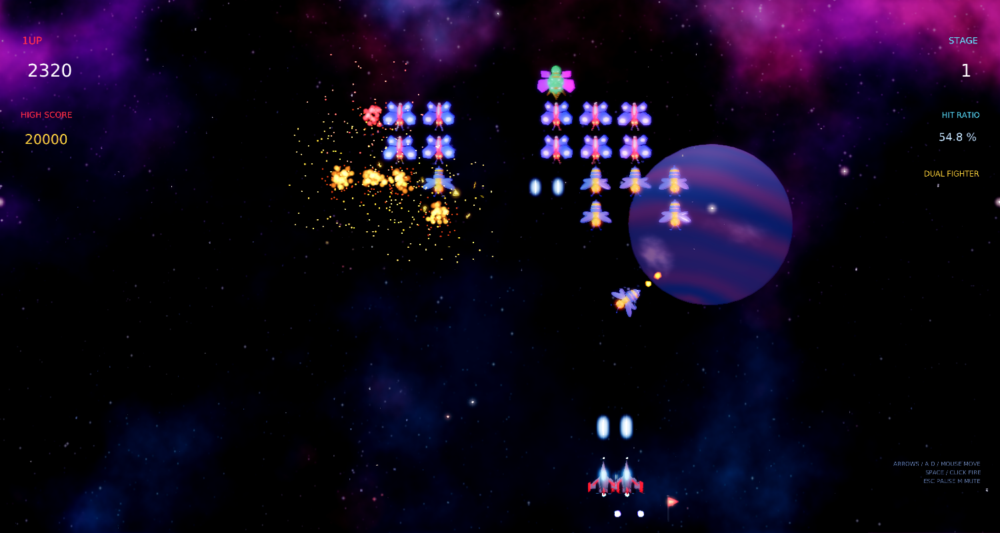

# Galaga Remix

A modernized remake of Namco's **Galaga** (1981) for [Phasma Engine](https://github.com/christoskaramou/PhasmaEngine), written in Lua.

## Run
- Windows: `run.cmd` (or `powershell -File run.ps1 [-Api vulkan|dx12]`). Uses the newest
  `..\..\PhasmaEngine\build*\Release\PhasmaPlayer.exe` with a private runtime copy in `%LOCALAPPDATA%\PhasmaGames\GalagaRemix`.

## Controls
| Action | Input |
|---|---|
| Move | Left/Right, A/D, or mouse |
| Fire | Space or left click (hold to auto-fire) |
| Pause menu | Esc or P |
| Mute | M |
| Menus | Mouse hover/click, or Up/Down + Enter |

## Gameplay (faithful to the arcade)
- A 40-ship formation (4 Boss Galaga, 16 butterflies, 20 bees) swoops in over 5 waves on looping entry paths,
  then sways and "breathes" in formation.
- Diving attacks: bees loop and swoop, butterflies weave, bosses dive with up to two escorts (400 / 800 / 1600 pts).
- Bosses take 2 hits (they turn blue). A boss can lower its **tractor beam** and capture your fighter. Shoot that boss
  while it dives to free the fighter: it docks beside you as a **dual fighter** (double firepower, wider target).
  Shoot it while it sits in formation and the captured fighter turns hostile.
- **Challenging stages** on stages 3, 7, 11 ...: 40 reskinned insects fly set patterns without firing. You get 100 per hit,
  a bonus for each full group of 8, and a 10,000-point PERFECT bonus.
- **Stage badges** (1 / 5 / 10 / 20 / 30 / 50 pennants) count up at the start of each stage. Extra fighters come at 20,000, 70,000 and
  then every 70,000. The game-over screen shows shots fired, hits and hit-miss ratio.

## Tech / visuals
- Detailed cooked insect ships (segmented bodies, stripes, eyes, mandibles, flapping wings) and the fighter are built
  procedurally by `tools/gen_meshes.py`, cooked with PhasmaCook, held as template nodes in `main.pescene` and cloned at runtime.
- Deep-space backdrop: a scrolling tileable nebula, a banded gas giant, and 3 parallax star layers with warp streaks between stages.
- Engine trails, layered explosions (core flash, fireball, sparks, embers, cooked debris, shockwave ring,
  light flash), an animated tractor beam (ribbon cone, scrolling rings, particles, light), dynamic lights, and screen shake.
- HDR + TAA + smooth bloom (`hdr=true, taa=true, bloom_strength 0.55, bloom_range 1.8`).
- Shared settings menu: volume (default 50%), SFX, mute, quality, bloom, AO, particles, shake, FPS. Every option is mouse-clickable.
- Assets regenerate with `tools/gen_meshes.py`, `tools/gen_assets.py` (textures, HDR sky, WAV sfx) and `tools/gen_scene.py`.

