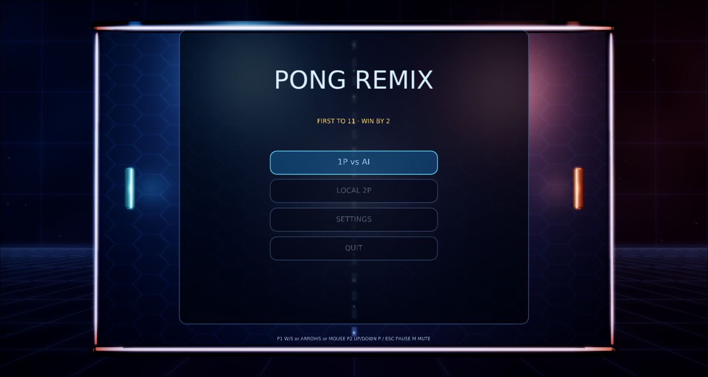
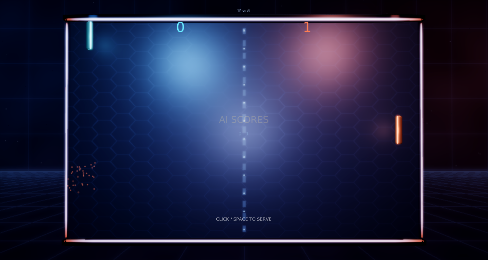
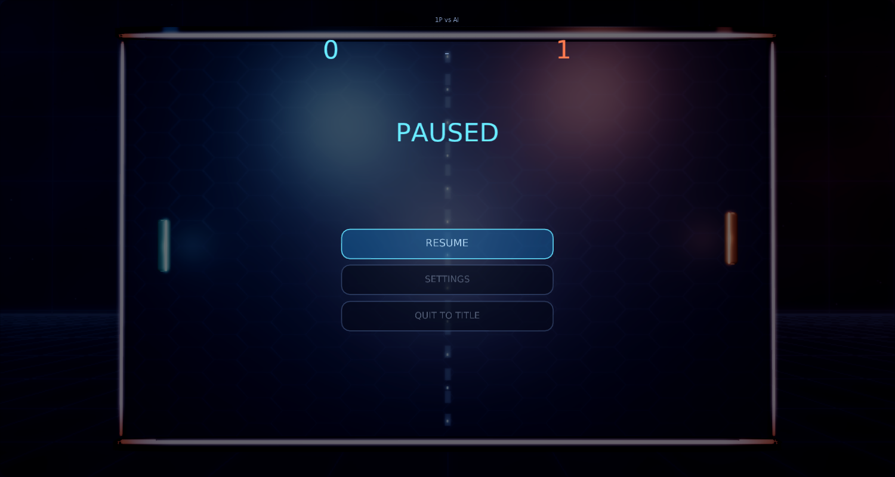
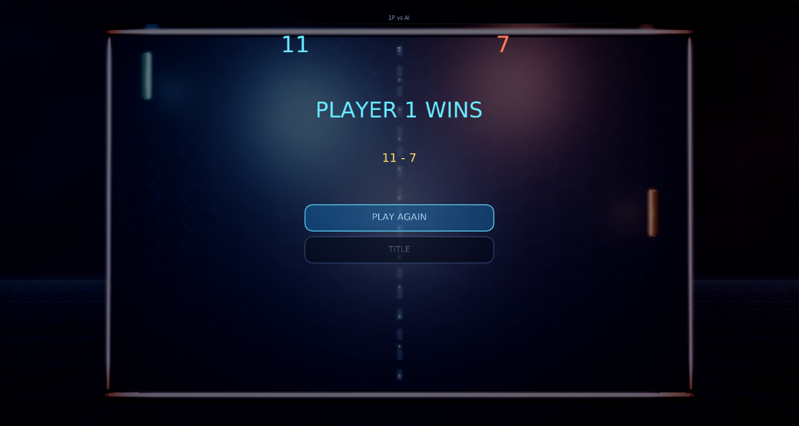

# Pong Remix

A modernized remake of Atari's **Pong** (1972) for [Phasma Engine](https://github.com/christoskaramou/PhasmaEngine), written in Lua.

## Run
- Windows: `run.cmd` (or `powershell -File run.ps1 [-Api vulkan|dx12]`). Uses the newest
  `..\..\PhasmaEngine\build*\Release\PhasmaPlayer.exe` with a private runtime copy in `%LOCALAPPDATA%\PhasmaGames\PongRemix`.
- Linux box: `./run.sh` (Xvfb + lavapipe), `./dev.sh` restarts only this game's player (MCP on :9129), `./stop.sh` stops it.

## Controls
| Action | Input |
|---|---|
| P1 move | W/S, Arrows (1P), or mouse |
| P2 move | Up/Down |
| Serve | Space or left click |
| Pause menu | Esc or P |
| Mute | M |
| Menus | Mouse hover/click, or Up/Down + Enter |

## Gameplay
- **1P vs AI** or **Local 2P**. First to 11, must win by 2.
- Bounce angle depends on where the ball hits the paddle; speed rises each rally.
- Smooth, frame-rate independent controls with forgiving paddle feel.

## Tech / visuals
- Cooked rounded paddles (body + emissive face + edge), UV-sphere ball with core, arena rails, centre markers, impact rings and shards.
- Ball trail ghosts, particle sparks, dynamic point lights, screen shake, HDR studio IBL.
- HDR + TAA + smooth bloom (`hdr=true, taa=true, cas_sharpening=false, bloom_strength 0.55, bloom_range 1.5`).
- Shared settings menu: volume (default 50%), SFX, mute, quality, bloom, AO, particles, shake, FPS. Every option is mouse-clickable.
- Assets regenerate with `tools/gen_meshes.py`, `tools/gen_assets.py` and `tools/gen_scene.py`.

