# PhasmaProjects

Small, free PhasmaEngine projects and game prototypes. This repo is meant to become
a showcase shelf: fast experiments, playable slices, and demos that prove the engine
can make real things quickly.

## Projects

| | Project | What it is |
|---|---|---|
| 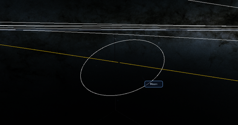 | [PhasmaSpace](./PhasmaSpace/README.md) | A real-scale solar-system demo with Lua-driven ephemerides, planet/moon catalogs, orbit guides, city lights, and a Gaia sky background. |
| 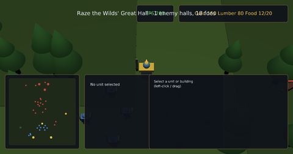 | [Warbound](./Warbound/README.md) | An original real-time strategy prototype in the classic 3D-RTS mold - angled command camera, hero + squad combat, base-building economy, an AI opponent, and a command-card HUD. |
| 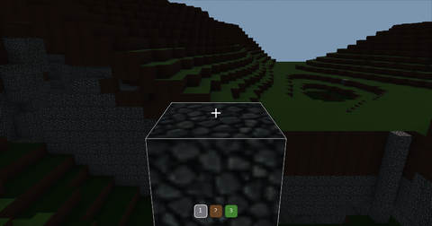 | [VoxelCraft](./VoxelCraft/README.md) | A Minecraft-style voxel playground: first-person movement, jumping, block outline, and break/place controls over PhasmaEngine's voxel runtime. |
| 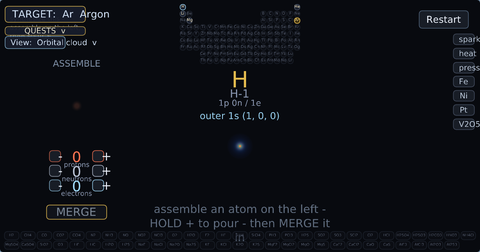 | [Ylem](./Ylem/README.md) | A tactile physics sandbox about coalescing matter - Lab builds real atoms (full table) from protons, neutrons, and electrons; Cosmos is planned later. |
| | [Sample](./Sample/) | The engine's default project: a content/lighting showcase (a neon "Las Vegas" scene) that the editor and launcher open out of the box. |

## Arcade

Modern remakes of classic arcade and Atari games, in [`Arcade/`](./Arcade/). Each one has its own README, screenshots and a Windows `run.cmd`.

| | Game | What it is |
|---|---|---|
| 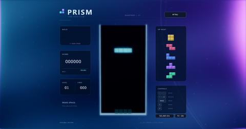 | [Prism Tetris](./Arcade/PrismTetris/README.md) | A crystal-aurora 3D Tetris with guideline speed, hold and a five-piece preview, plus a side-by-side race against the Jev model on identical pieces. It runs the PhasmaPlayer.exe from a PhasmaEngine build, which `run.ps1` finds by searching upward from the game folder for a `PhasmaEngine` folder (for example `C:\Users\Christos\repos\PhasmaEngine`), or from the `PHASMA_ENGINE` environment variable. |
| 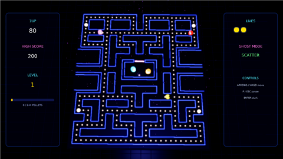 | [Pac-Man Remix](./Arcade/PacManRemix/README.md) | A 3D Pac-Man remake - maze chases, frightened ghosts, and particles everywhere. |
| 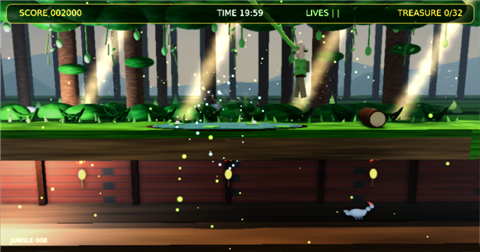 | [Pitfall! Remastered](./Arcade/PitfallRemastered/README.md) | Pitfall! rebuilt in 3D: vine swings over the swamp, crocodiles, and treasure tunnels. |
| 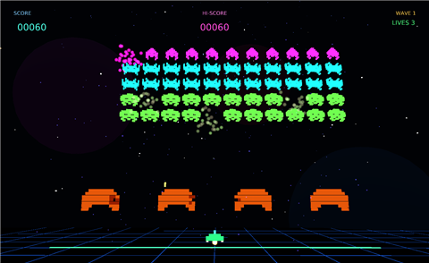 | [Neon Invaders](./Arcade/NeonInvaders/README.md) | A modern Space Invaders remake with glowing alien waves, explosions, and the UFO. |
| 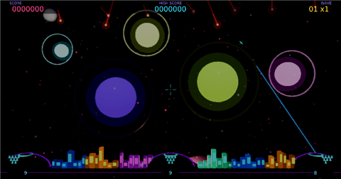 | [Missile Command](./Arcade/MissileCommand/README.md) | Mouse-aimed Missile Command: three bases, incoming warheads, and a bonus tally between waves. |
| 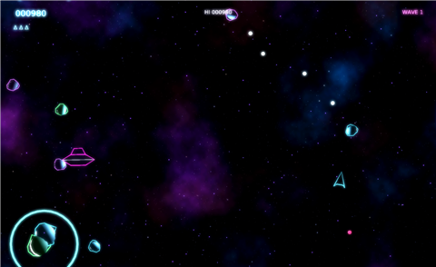 | [Neon Asteroids](./Arcade/NeonAsteroids/README.md) | Asteroids with a vector-glow look - rotate, thrust, fire, and hyperspace out of trouble. |
| 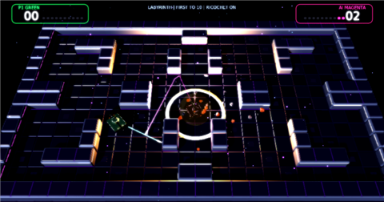 | [Neon Combat](./Arcade/NeonCombat/README.md) | A modern remake of Atari 2600 *Combat*: two tanks duel across maze arenas, versus a friend or the AI. |
| 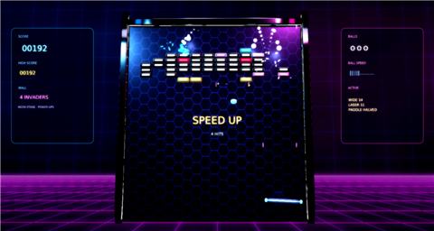 | [Neon Breakout](./Arcade/NeonBreakout/README.md) | A VFX-heavy remake of Atari's Breakout (1976), written in Lua, with power-ups. |
| 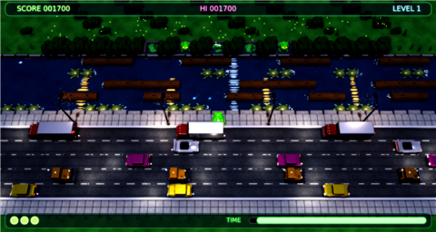 | [Frogger Remix](./Arcade/FroggerRemix/README.md) | Konami's Frogger on a twilight city street, with moving headlights and a glossy river. |
| 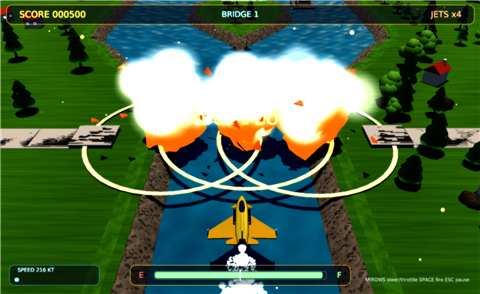 | [River Raid Remix](./Arcade/RiverRaidRemix/README.md) | A 3D River Raid with a procedural river, fuel depots, bridges as checkpoints, and the classic scoring. |
| 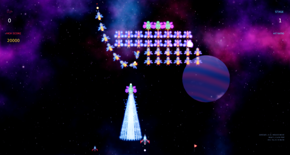 | [Galaga Remix](./Arcade/GalagaRemix/README.md) | Galaga (1981) remake: swooping formation, diving attacks, boss tractor-beam capture and dual-fighter rescue, challenging stages, stage badges. |
| 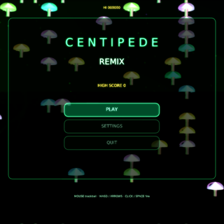 | [Centipede Remix](./Arcade/CentipedeRemix/README.md) | A modernized remake of Atari's Centipede (1981), set on a bioluminescent forest floor. |
| 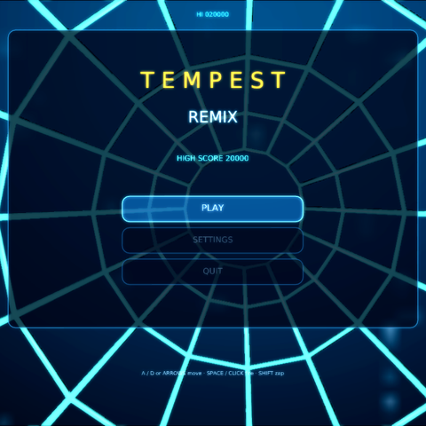 | [Tempest Remix](./Arcade/TempestRemix/README.md) | Modern tube-shooter remake of Atari Tempest (1981). Glowing rail web, cooked claw & enemies, TAA + soft bloom, clickable settings. |
| 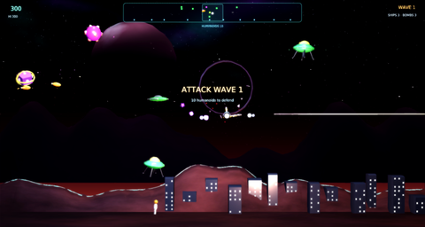 | [Defender Remix](./Arcade/DefenderRemix/README.md) | Modern remake of Williams Defender (1981). Wrap-around planet, scanner, abducting Landers, cooked ships, layered explosions, TAA + soft bloom, clickable settings. |
| 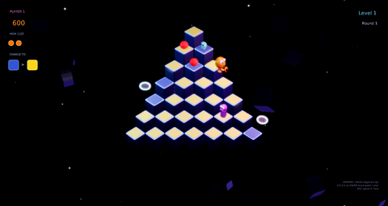 | [Q*bert Remix](./Arcade/QbertRemix/README.md) | A modernized remake of Gottlieb's Q\*bert (1982). |
| 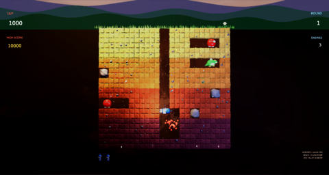 | [Dig Dug Remix](./Arcade/DigDugRemix/README.md) | Modern remake of Namco's Dig Dug (1982). Dig through four strata of cooked voxel earth, pump Pookas and Fygars until they pop, drop rocks for crush combos, dodge ghosts and fire breath. Headlamp lighting, crumbs/dust/confetti VFX, TAA + soft bloom, clickable settings. |
| 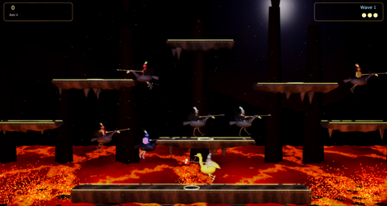 | [Joust Remix](./Arcade/JoustRemix/README.md) | Modern remake of Williams Joust (1982). Flap-to-fly jousting over a lava lake, eggs that hatch into tougher knights, a lava troll, cooked riders with flapping wings, ember and clash VFX, TAA and soft bloom, clickable settings. |
| 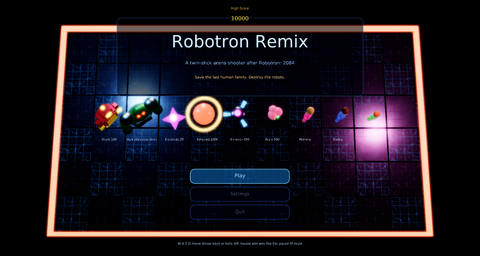 | [Robotron Remix](./Arcade/RobotronRemix/README.md) | Robotron: 2084 (1982) remake: twin-stick arena shooter with homing Grunts, indestructible Hulks, Spheroids and Enforcers, Brains, and last-human-family rescues. |
| 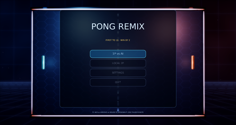 | [Pong Remix](./Arcade/PongRemix/README.md) | Modern remake of Atari Pong (1972). 1P vs AI and local 2P, first to 11 win-by-2, cooked paddles/ball, trails, sparks, HDR + TAA + soft bloom, clickable settings. |
| 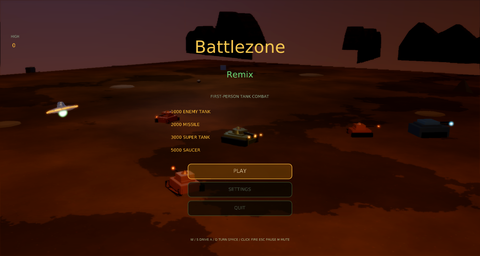 | [Battlezone Remix](./Arcade/BattlezoneRemix/README.md) | Modern first-person tank remake of Atari Battlezone (1980). Cooked tanks & mountains, radar, HDR + TAA + soft bloom, clickable settings. |
| 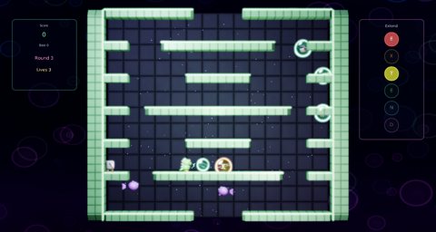 | [Bubble Bobble Remix](./Arcade/BubbleBobbleRemix/README.md) | Modern remake of Taito Bubble Bobble (1986). Trap monsters in bubbles and pop them in chains for fruit, EXTEND letter bubbles, a wrap-through floor, Baron von Blubba on hurry-up, cooked 3D dragon, monsters and bubbles, pop VFX with dynamic lights, HDR, TAA and soft bloom, clickable settings. |
| 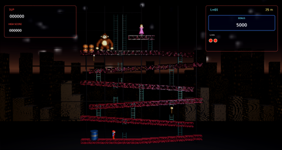 | [Donkey Kong Remix](./Arcade/DonkeyKongRemix/README.md) | Faithful 3D remake of Nintendo Donkey Kong (1981). The intro climb and girder stomp, all four original stages (25m barrels, 50m conveyors and cement pies, 75m elevators and springs, 100m rivets) with the original layouts, US stage order, bonus timer, hammers, fireballs and firefoxes, plus the stage-clear and ending cutscenes. Cooked 3D Mario, Kong and Pauline, a night-city backdrop, fire and smash VFX, TAA, soft bloom, and an F3 collider overlay. |

## Getting started

### 1. Get the projects

Clone the repo:

```bash
git clone https://github.com/christoskaramou/PhasmaProjects.git
```

Or download it as a zip from the GitHub page (**Code > Download ZIP**) and extract it.
Either way, put it beside your PhasmaEngine folder (see the layout below).

### 2. Get the Phasma Engine

**Prebuilt binaries.** The engine's [`latest` prerelease](https://github.com/christoskaramou/PhasmaEngine/releases/tag/latest)
("Development Build", rebuilt from `master`) ships:

- [PhasmaEngine-Full-Windows.zip](https://github.com/christoskaramou/PhasmaEngine/releases/download/latest/PhasmaEngine-Full-Windows.zip) - Vulkan and DX12
- [PhasmaEngine-Full-Linux.tar.gz](https://github.com/christoskaramou/PhasmaEngine/releases/download/latest/PhasmaEngine-Full-Linux.tar.gz) - Vulkan

**From source.** Clone with submodules (Tracy is one):

```bash
git clone --recurse-submodules https://github.com/christoskaramou/PhasmaEngine.git
```

Then configure and build with one of the CMake presets in `CMakePresets.json`:

| Configure preset | What you get | Output folder |
|---|---|---|
| `ninja` / `vs` | Editor + core only, the fastest build | `build-ninja` / `build-vs` |
| `ninja-physics` / `vs-physics` | + Jolt Physics | `build-ninja-physics` / `build-vs-physics` |
| `ninja-webgpu` / `vs-webgpu` | + the PhasmaWebGPU layer | `build-ninja-webgpu` / `build-vs-webgpu` |
| `ninja-full` / `vs-full` | WebGPU + Physics | `build-ninja-full` / `build-vs-full` |
| `ninja-full-tracy` / `vs-full-tracy` | Full + Tracy profiler | `build-ninja-full-tracy` / `build-vs-full-tracy` |

`ninja-*` presets use Ninja Multi-Config; `vs-*` use Visual Studio 2022 (x64). Each one has
`-debug`, `-release`, `-relwithdebinfo` and `-minsizerel` build presets. For example:

```bash
cmake --preset ninja-physics
cmake --build --preset ninja-physics-release
```

This gives you `build-ninja-physics/Release/` with `PhasmaLauncher`, `PhasmaEditor`, `PhasmaPlayer`
and friends. That is the exact build Prism Tetris's launcher expects.

### 3. Folder layout

Keep the two checkouts side by side. The arcade games' `run.cmd` / `run.ps1` scripts walk up from their
own folder and use the first `PhasmaEngine` checkout they find beside a parent folder (set `PHASMA_ENGINE`
to override). Prism Tetris (`Arcade\PrismTetris`) uses the same upward search, needs the `build-ninja-physics` Release build and refuses to start without it.

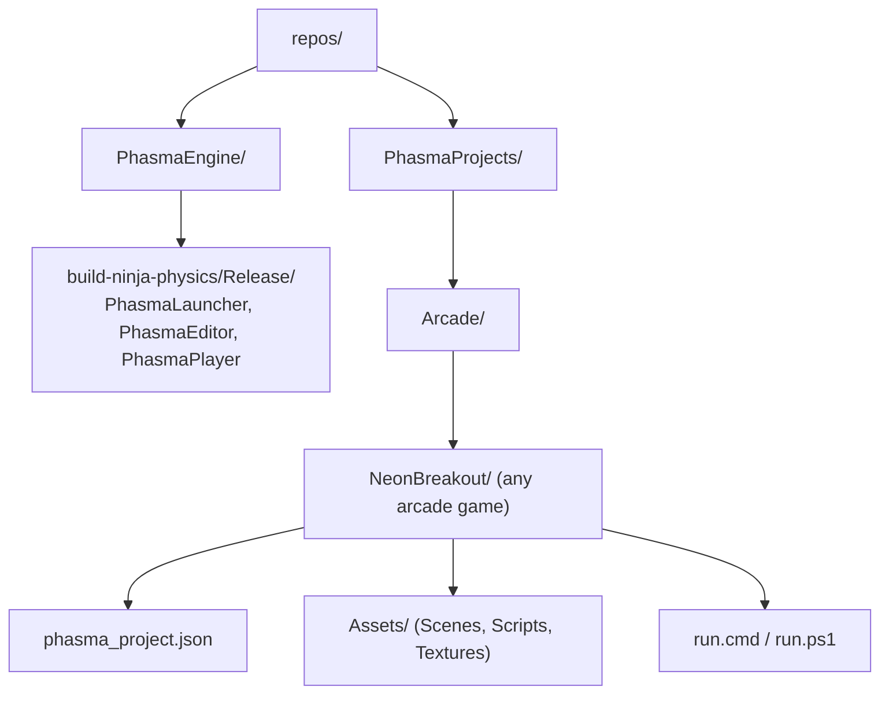

```text
repos/
  PhasmaEngine/
    build-ninja-physics/Release/   PhasmaLauncher.exe, PhasmaEditor.exe, PhasmaPlayer.exe, RuntimeAssets/
  PhasmaProjects/
    Arcade/
      NeonBreakout/
        phasma_project.json
        Assets/Scenes/main.pescene
        run.cmd
        run.ps1
    Warbound/, VoxelCraft/, ...
```

### 4. Run a project

**With the launcher (easiest).** Start `PhasmaLauncher`, open the **Project** picker and select a
project folder (the one with `phasma_project.json`). Pick a startup scene from `Assets/Scenes` if the
manifest doesn't set one. The launcher writes your choice to `phasma_settings.json` next to the
executable, and `PhasmaEditor`, `PhasmaPlayer` and `PhasmaAnimator` all open that project.

**In the editor.** Once the project is selected, `PhasmaEditor` opens it. Pick the graphics API with
`PhasmaEditor --api vulkan` (default) or `PhasmaEditor.exe --api dx12` (Windows only).

**PhasmaPlayer directly.** Write `phasma_settings.json` next to the executable yourself. Use forward slashes on Windows:

```json
{
    "project_path": "C:/path/to/PhasmaProjects/Arcade/NeonBreakout/",
    "project_manifest": "C:/path/to/PhasmaProjects/Arcade/NeonBreakout/phasma_project.json",
    "startup_scene": "Assets/Scenes/main.pescene"
}
```

**The game scripts (the new games).** PacManRemix, PitfallRemastered, NeonInvaders, MissileCommand,
NeonAsteroids, NeonCombat, NeonBreakout, FroggerRemix, RiverRaidRemix and the eleven new remixes
(Galaga, Centipede, Tempest, Defender, Q*bert, Dig Dug, Joust, Robotron, Pong, Battlezone, Bubble Bobble) live in `Arcade\` and each have a
Windows `run.cmd` (a wrapper around `run.ps1`):

```powershell
.\Arcade\NeonBreakout\run.cmd
# or
powershell -File .\Arcade\NeonBreakout\run.ps1 -Api vulkan -Display 1
```

`run.ps1` takes the newest `PhasmaEngine\build*\Release\PhasmaPlayer.exe` that has `RuntimeAssets`
beside it. It copies it to a private runtime folder at `%LOCALAPPDATA%\PhasmaGames\<game>`, writes that
copy's own `phasma_settings.json`, and launches it. This way your editor's settings are never touched.
The log goes to `PhasmaEngine.log` in that folder.

**Prism Tetris.** `Arcade\PrismTetris\run.cmd` (or `run.ps1 -Port 8876`) needs `PhasmaEngine\build-ninja-physics\Release`.
It builds a runtime copy in `PhasmaEngine\build-prism-tetris\player`. To race Jev, it also needs
`build-game-driver\Release\PhasmaGameDriver.exe` (build it with `Phasma/GameDriver/build.ps1` in the engine).
In the game, Enter plays solo and V races Jev.
