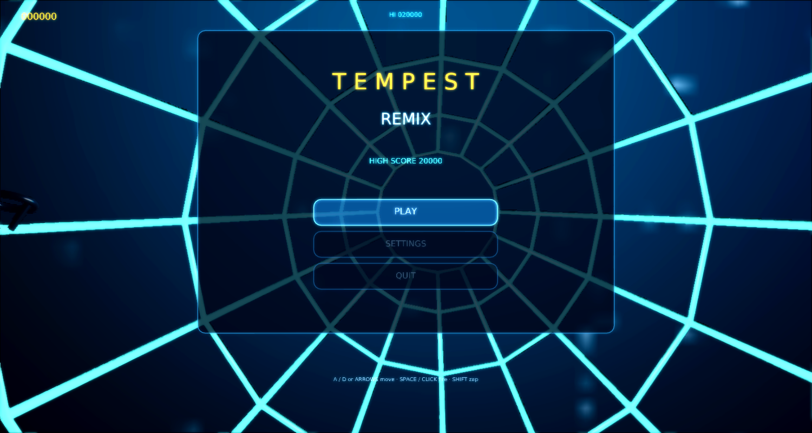

# Tempest Remix

A modernized remake of Atari's **Tempest** (1981) for
[Phasma Engine](https://github.com/christoskaramou/PhasmaEngine) — claw on the rim,
enemies climbing the web, superzapper ready.



## Highlights
- **Faithful tube-shooter core**: claw crawls the near rim, zappers fire into the web,
  flippers / tankers / spikers / fuseballs / pulsars advance from the far hub.
  Superzapper once per life. Levels cycle CIRCLE → SQUARE → PLUS → TRIANGLE → HEXAGON → STAR → CLOVER → OCTAGON.
- **Cooked meshes**: claw (body / prongs / glow / metal), enemy ships, rail segments, hub, spikes, bolts —
  generated by `tools/gen_meshes.py`, cooked with `PhasmaCook`, cloned from `.pescene` templates at runtime.
- **VFX**: glowing rail web with depth rings, particle bursts, shock rings, dynamic point lights on the claw / hub / hits,
  void HDR IBL.
- **TAA + soft bloom** (see `/workspace/games/common/RENDER_SETTINGS.md`): `taa` on,
  `cas_sharpening` off (so bloom is not overwritten), `bloom_range` 1.4, `bloom_strength` 0.55, `hdr` on, motion blur off.
- Shared **settings menu** (`Assets/Scripts/Lib/settings_menu.lua`): master volume defaults to 50%,
  mouse-clickable options. Title / pause / game-over buttons are mouse-clickable.

## Controls
| Input | Action |
|---|---|
| A / D or Left / Right | Move along the rim |
| Space / Z / Click | Fire |
| Shift / X / Ctrl | Superzapper |
| Esc / P | Pause menu |
| O | Settings |
| M | Mute |

## Run (Windows)
```powershell
.\run.ps1          # or double-click run.cmd
```
Needs a local Phasma Engine build at `../../PhasmaEngine/build*/Release/PhasmaPlayer.exe`
relative to this folder. `run.ps1` copies the player into `%LOCALAPPDATA%\PhasmaGames\TempestRemix`.

## Regenerating assets
`tools/gen_meshes.py` → OBJ → `PhasmaCook` → `Assets/Objects/*.pemesh`.
`tools/gen_assets.py` writes textures, HDR sky and WAV sfx. `tools/gen_scene.py` writes templates.

## Playtest fixes (2026-10-16)
- **Missing objects:** zero-area triangles in the claw, bolt and enemy meshes made PhasmaCook split them, and the first sub-mesh went invisible. `gen_meshes.py` now drops those triangles and every mesh cooks to a single mesh. Removed the white halo orbs that hid every enemy's shape, and turned enemy emissive down so flippers, tankers, spikers, fuseballs and pulsars are readable.
- Entities ride the **lane centres** (they used to sit on the rails). Shots are swept, so they can't tunnel through enemies at low FPS.
- **Camera** distance is computed from the FOV and aspect ratio, so the whole tube is on screen as in the arcade.
- **Level transition:** the claw dives down its lane while the camera flies through the tube. The next tube shape then zooms in from the distance. Leftover spikes on your lane still kill you on the way down, as in the original.
- Fixed-step simulation (1/40 s substeps), so speed doesn't depend on FPS.

## Pace fix (Oct 2026): "it goes fast in some levels"
- Cause: lane count came from each shape's vertex count (Circle 16, Square 4, Plus 12, Triangle 3, Hexagon 6, Star 16, Clover 24, Octagon 8). Claw speed and flipper flips are measured in lanes, so on the Triangle the claw went round about 5x faster than on the Circle and flippers crossed a third of the web per flip. Rim flippers also re-flipped every few frames. Enemy climb speed ramped 2.5x by level 15.
- Fix: every web now has 16 lanes like the arcade. Polygon corners are kept, each edge gets lanes in proportion to its length, and the Clover is resampled by arc length. Claw speed is 4.6 lanes/s (+0.6 max over the levels). Enemy climb speed ramps gently (+60% max by about level 13). Rim flippers step one lane toward you every 0.6 s (min 0.4 s). Mid-web flips happen every 0.5–1.2 s.
- Verified: one second holding Right gives the same claw travel and enemy depth at 144, 30 and 4 FPS on all 8 shapes.
